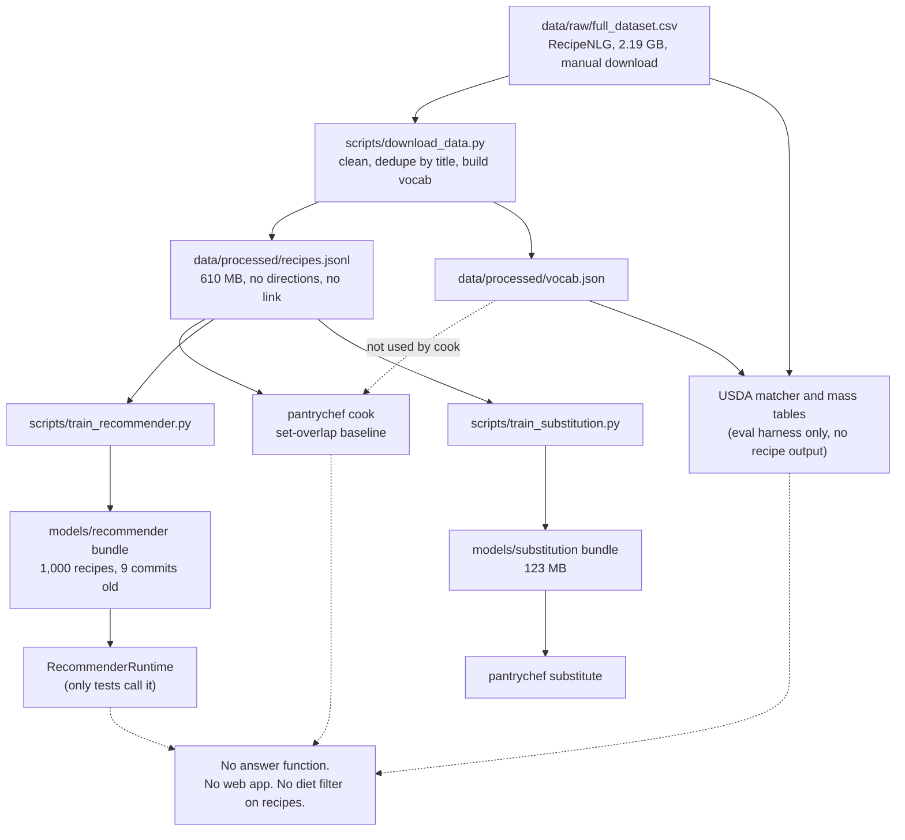

# PantryChef: project state

Date: 2026-10-30. Audited commit: `d49f02c`. Updated for M0, merged in PR #6 (section 3), and for M1, merged in PR #7 and deployed (section 10, 2026-11-03).
Sources: ADRs [0003](decisions/0003-licence-clean-recipe-corpus.md), [0004](decisions/0004-static-first-browser-engine.md), [0005](decisions/0005-honest-claims-and-eval-reset.md); the [Stage 1 synthesis](research/2026-10-stage1/README.md) and its [review](research/2026-10-stage1/REVIEW.md); the repo itself. For findings and fixes, read [TECHNICAL_AUDIT.md](TECHNICAL_AUDIT.md).

Labels: MEASURED (a run or a log shows it), ESTIMATE (a calculation), HYPOTHESIS (a test must confirm it).

## 1. Summary

PantryChef is meant to be a pantry-first recipe app. A user lists what they have. The app shows what they can cook now, and the top items that would move the most recipes to make now (on zero results, the single change that returns the most results). Today it is a Python library with 246 passing tests (MEASURED, 91% to 92% coverage, depending on local data files). It has a parser, a recommender, a substitution model and a nutrition estimator. It has no app, no web page and no single "pantry in, answer out" function. The main published results do not survive a hard test. The project owner accepted three decisions on 2026-10-30. They change the data source, the hosting plan and the claims policy.

## 2. Status by capability

| Capability | Status | Evidence |
| --- | --- | --- |
| Ingredient parser (rules plus vocabulary match) | Built and tested | `pantrychef/ingredients/parser.py`; unit tests pass. Dev-half score on a model-labelled gold set: [results/m2_parser_gold_dev.json](../results/m2_parser_gold_dev.json) |
| Set-overlap baseline retrieval and `cook` command | Built and tested | `pantrychef/retrieval/`, `pantrychef/cli.py:26` |
| Recommender: candidate pool plus LambdaMART (a learned ranking model) | Built, not usable by a person | Only tests call `RecommenderRuntime`. `cook` does not use it |
| Substitution model (graph and embedding arms) | Built and tested | `pantrychef/substitution/`; `substitute` command loads the 123 MB bundle (not run in this audit) |
| Dietary filter | Built, unsafe | Tagger judges 18.7% of the vocabulary. Wrong on gluten and vegan cases. See audit C2 |
| Nutrition estimate | Built, not fit to show | Wrong matches and masses. See audit C3 |
| Computer vision ("by photo") | Planned, gated (M8) | No code. M0 deleted the empty stub |
| Two-tower model, FAISS, NER, ONNX | Not built | No code, no dependency. M0 removed the claims and the unused Hydra configs and MLflow |
| API server, Docker path | Not built | M0 deleted the Docker placeholders, the `serving` stub and `make serve` |
| Production recommender bundle | Does not exist | Disk bundle holds 1,000 recipes. M0 corrected the docs that said otherwise |
| Static web app with browser engine (ADR 0004) | Built, merged (PR #7) and live at <https://aritr-codes.github.io/PantryChef/> | `web/`; Vitest parity on golden cases; Playwright smoke test on the fixture pack (section 10) |
| Wikibooks display pack (ADR 0003) | Built (M1) | 3,712 recipes; `build/pack` is not in git (section 10). Open Recipes statistics: planned |
| Rebuilt ingredient table | Built (M1), 337 rows | `data/ingredients/ingredients.csv`. The old `vocab.json` still comes from RecipeNLG and the new table never reads it |
| New evaluation with hand-judged pantries (ADR 0005) | Planned | Not started |

## 3. Git state

- `main` holds PR #5 as merge commit `68ae83f` (MEASURED with `gh pr view 5`). It holds the parser fix, the hash-order sampling, the 10k training cap and docs. M0 corrected the claims in its docs.
- PR #6 merges the M0 work from branch `chore/m0-reset` into `main`.
- Tags: `v0.1.0`, `v0.2.0`, `v0.3.0`, `v0.4.0`. The package version is now `0.4.0`.
- Other branches: `fix/parser-doubled-token-coverage` (merged), and remote-only `feat/phase3-full-corpus`, `feat/phase4-nutrition`.
- Untracked, and not committed unless the owner says so: `.codegraph/`, `CODEX_HANDOFF.md`, `TestRun.md`, `scratch_codex_audit_prompt.md`, `temp_pytest/`.
- Withheld from git: `docs/research/2026-10-stage1/evidence/subs_out.json`. It holds output of a model trained on RecipeNLG (ADR 0003). Git ignores it, and `evidence/run_subs.py` rebuilds it.
- Corpus snapshots stay under `data/raw/`, which git ignores. Hashes are in [DATASET.md](DATASET.md).
- `experiments/mlruns/` stays on disk from old MLflow runs (4 runs, parameters only). Git ignores it. No code reads it.

### M0 measurements (2026-10-30)

MEASURED on Windows, in a fresh clone of commit `8acc63c`:

- `uv sync --extra dev`, then `uv run pytest --collect-only`: 7 collection errors (`No module named 'scipy'`). This confirms the old failure.
- `uv sync --all-extras`, then `uv run pytest`: 246 passed. `ruff check` and `ruff format --check` are clean. `uv run pantrychef --help` works.
- `pip-audit` on the locked packages after removing MLflow and upgrading the lock: no known vulnerabilities. The old 16 flagged packages needed no reachability review, because none remains flagged.

MEASURED in CI on PR #6 ([run 41092251895](https://github.com/aritr-codes/PantryChef/actions/runs/41092251895)), on Linux and Windows: 246 passed, 91% coverage, `ruff` clean, `uv run pantrychef --help` works, and `pip-audit` found no known vulnerabilities.

Major upgrades in the lock: pandas 2 to 3, ruff 0.15 to 0.17, python-dateutil 2 to 3, smart-open 7 to 9, filelock 3 to 4. All tests pass. No full-corpus job ran on the new versions.

## 4. Actual data flow today

Where the flow breaks:

- `cook` does not use the parser, the vocabulary or the ranker (`pantrychef/cli.py:26-33`). It rebuilds the index on each call.
- The recommender runtime has no caller outside tests.
- The cleaning step drops `directions` and `link` and blanks `ingredients_raw` (`pantrychef/data/store.py:47`). Results cannot show steps or quantities.
- Nutrition has no link to any recipe output.
- The recommender has no diet input. Its `dietary_ok` feature is the constant `1.0` (`pantrychef/recommender/features.py:77`).

## 5. Artifacts on disk (MEASURED, 2026-10-30)

| Path | Size | Note |
| --- | --- | --- |
| `data/raw/full_dataset.csv` | 2,188.7 MB | RecipeNLG. No checksum. Do not load whole |
| `data/raw/dataset.zip` | 591.9 MB | Source archive |
| `data/raw/usda_fdc/` | about 100 MB | USDA FoodData Central, Foundation and SR Legacy |
| `data/raw/gismo/*.pkl` | 1.2 MB | GISMo gold files (CC BY-NC) |
| `data/processed/recipes.jsonl` | 610.3 MB | Cleaned recipes. Do not load whole |
| `data/processed/recipes.buggy.jsonl` | 624.9 MB | Pre-fix copy. Disposable |
| `data/processed/vocab.json`, `usda.json` | 0.5 MB, 2.2 MB | RecipeNLG-derived vocabulary cannot ship (ADR 0003) |
| `data/processed/*.log` | about 8 MB | Evidence logs. Git ignores them |
| `data/eval/subs_gold.csv`, `subs_gold_gismo.csv` | 2.7 KB, 166 KB | Git ignores both |
| `models/recommender/recommender_bundle.zip` | 0.3 MB | 3 models, 1,000 recipes, 767 groups |
| `models/recommender/learning_curve.json` | under 1 KB | Learning-curve output |
| `models/substitution/substitution_bundle.zip` | 122.9 MB | Mined from the pre-ADR corpus |
| `models/substitution/word2vec.kv` | 12.3 MB | Pickle-based gensim file |

## 6. What a person can run today

I confirmed each command exists in the code. I did not run them: free RAM is about 1 GB, and the recipe file is 610 MB.

| Command | Does | Needs |
| --- | --- | --- |
| `uv sync --all-extras` | Installs everything. `--extra dev` alone gives 7 test collection errors (MEASURED, section 3) | uv |
| `uv run pytest` | Runs 246 tests (MEASURED, section 3) | all extras |
| `uv run pantrychef cook --have eggs,flour,milk --k 5` | Ranks recipes by overlap (`cli.py:26`) | `data/processed/recipes.jsonl` |
| `uv run pantrychef substitute butter --diet vegan --k 5` | Lists substitutes (`cli.py:43`). Choices: vegan, vegetarian, gluten_free, dairy_free | substitution bundle |
| `uv run python -m pantrychef.eval` | Prints P1 recall@10 (`eval/__main__.py`) | recipes and vocab |
| `uv run python -m pantrychef.eval.recommend_main` | Scores a saved bundle. Options: `--mask-fraction`, `--seed`, `--no-subs`, `--max-eval-queries` | bundle, recipes |
| `uv run python scripts/train_recommender.py` | Trains a bundle. Options: `--max-rows`, `--mask-fraction`, `--seed`, `--output`. Default cap 10,000 training queries | recipes. RAM-blocked here |
| `uv run python scripts/train_substitution.py` | Trains the substitution bundle | recipes |
| `uv run python scripts/download_data.py` | Cleans the raw CSV. It does not download it. You fetch the CSV by hand | `full_dataset.csv` |
| `uv run python scripts/reclean.py` | Re-cleans into a new file | raw CSV |

Kaggle: run Kaggle tooling with `uvx kaggle`.

## 7. Published numbers

| Number | Verdict |
| --- | --- |
| P2 MRR 0.289 (graph) vs 0.259 (food2vec), n=82 | Reproduces. Does not support "beats": the 95% interval for the difference is -0.048 to +0.111. Retired as a headline (ADR 0005) |
| P3 recall@10 0.980 vs 0.746, 50k recipes, n=9,354 | Reproduces. Measures the query generator. A no-ML rule scores 0.975 on a 1,404-query set. Keep as a sanity test only |
| P3 full-corpus 7.7x lead, ceiling 0.706 | Pre-fix. No post-fix all-arms run exists (`MemoryError`). Retracted |
| "Saturates at 10k" (learning curve) | Not supported. The metric sees only the gold slot. Retracted |
| 100% dietary validity | Retracted. The check uses the same tagger as the filter, so it cannot fail |
| P4 nutrition coverage 0.800 / 0.487 | Retracted. First 5,000 rows only. Random sample: 0.710 / 0.439 |
| P1 F1 0.864, recall@10 0.873 | No log on disk. Unsupported |
| GISMo comparison | Pre-fix. Never rerun. Unsupported |
| 246 tests, 91% to 92% coverage | Stand. 92% in this working copy and 91% in a fresh clone, at the same commit |
| sub_fill null result (0.9349 vs 0.9347) | Stands. It is an honest null |

Full ledger: 43 claims. 14 FALSE, 11 UNSUPPORTED, 11 STALE, 7 TRUE ([report 07](research/2026-10-stage1/07_engineering_claims.md)).

## 8. Accepted decisions (2026-10-30)

- [ADR 0003](decisions/0003-licence-clean-recipe-corpus.md): the public app uses Wikibooks Cookbook (CC BY-SA 4.0, 3,800 recipes) for display and Open Recipes (CC BY 3.0, 173,276 recipes) for statistics only. RecipeNLG is for research. The vocabulary will be rebuilt. Open Recipes statistics ship only if mined swaps pass the M5 blind rating. Otherwise nothing from Open Recipes ships.
- [ADR 0004](decisions/0004-static-first-browser-engine.md): a static site on GitHub Pages with a small TypeScript engine in the browser (a Web Worker only if latency requires it). Python stays the reference. A golden-file test must prove both give the same results.
- Proposed, not accepted: [ADR 0006](decisions/0006-hybrid-graph-knowledge-base.md), a graph knowledge base with ML on top. A spike in M3 decides.
- [ADR 0005](decisions/0005-honest-claims-and-eval-reset.md): retract the headlines. Keep masked recovery as a sanity test with the no-ML rule on the leaderboard. A learned ranker ships only if it beats the IDF rule on hand-judged pantries. Nutrition stays out of release 1. The diet filter is a three-state preference filter with no allergen claim. Every published number links to a results file.

## 9. Environment

- RAM: about 1 to 2 GB free of 16 GB. Full-corpus work is blocked.
- GPU: NVIDIA MX150 (small; not used by any current code).
- Disk: 48.6 GB free on `G:`.
- OS: Windows 10. Shell: PowerShell or Git Bash.
- Kaggle: use `uvx kaggle` for heavy jobs.
- Python 3.11 in CI on Linux and Windows (`.github/workflows/ci.yml`). Locked with `uv.lock`.

## 10. M1 thin slice (2026-11-03, merged in PR #7, deployed)

The repository was renamed from `PantryChef-` to `PantryChef` on 2026-11-03. GitHub redirects the old git URL, but the old Pages URL gives 404.

Plan: [docs/plans/2026-11-02-m1-thin-slice.md](plans/2026-11-02-m1-thin-slice.md).

| Item | Result | Label |
| --- | --- | --- |
| Pack | 3,712 recipes, 337 ingredients, 32,746 lines, 2,242 unread lines. `core.v1.json.gz` 476,092 bytes, `text.v1.json.gz` 870,411 bytes | MEASURED (`build/pack/manifest.v1.json`) |
| Core download | `core` 0.48 MB plus the app bundle 11 KB gzip. The text pack loads when a recipe opens. The limit is 3 MB | MEASURED |
| Ingredient coverage | 92.7% of required lines read, 60.3% of recipes fully read. In-sample, so it shows cost and not quality. A wrong read is not a missing read | MEASURED, in-sample ([coverage.md](research/2026-11-m1/coverage.md)) |
| Wrong-read rate | About 2 in 90 in one sample and about 6 in 25 in the review sample before the fixes | ESTIMATE; M3 measures it on held-out data |
| Parity | TypeScript matches Python on 202 golden cases plus token and name cases: scores within 1e-9, order exact. Vitest: 237 tests pass | MEASURED |
| Python tests | 374 pass; `ruff check` and `ruff format --check` are clean | MEASURED |
| Guard | A test fails a build that opens a file outside the allow-list, writes outside the output folder, or starts a process. It is a tripwire and not a sandbox | MEASURED |
| Smoke test | Playwright on the fixture pack (5 tests): add items, see groups and an unlock line, open a recipe, see the source link, revision and licence, no off-origin request, focus and unknown-name cases. Passes locally and in CI (PR #7). The same flow on the live site gave 89 make-now, 175 one-away and an unlock line for a 5-item pantry, with no off-origin request | MEASURED |
| Search latency | `answer()` in headless Chromium with a 6x CPU throttle, dev server, real pack: Three runs of 160 calls each (pantries of 3, 5, 8 and 12 items from the 120 most common ingredients; first 3 calls per size dropped). Overall p50 42 to 43 ms. Overall p95 78, 65 and 62 ms. Worst single call 85 to 130 ms. Worst per-size p95 88 ms. First call after load 97 to 127 ms. Pack load 0.4 to 0.7 s. Under heavy memory pressure an earlier run reached p95 156 to 173 ms | MEASURED ([run 1](../results/m1_latency_run1.json), [run 2](../results/m1_latency_run2.json), [run 3](../results/m1_latency_run3.json)). The `dirty` flag in these files is true only because the old `m1_latency.json` was deleted in the same change |

Latency verdict: the p95 is under 100 ms in these three runs, but single calls and the first call can pass 100 ms, and the laptop's low free RAM made two earlier runs go over (p95 156 and 173 ms; those result files were not kept). The dev server serves unminified code. The Web Worker plan is recorded in each result file. Moving the engine to a Worker is the planned fix if the production bundle shows p95 over 100 ms on a normal machine. A run on the production bundle is still to do. The 6x throttle is a model of a low-end phone and not a measurement of one (HYPOTHESIS).

Deployed bundle, end to end (MEASURED, one run, [results/m1_latency_live.json](../results/m1_latency_live.json)): from the click on "See recipes" to the results painted, headless Chromium, 6x CPU throttle after load, cache off, 13 timed runs per pantry size. Median 425 to 499 ms and p95 529 to 674 ms for pantries of 3, 5, 8 and 12 items. Without the throttle the same click takes about 57 ms (two animation frames included). Page ready (unthrottled, real network) had a median of 0.57 s and p95 1.16 s. This is far above 100 ms. It includes rendering and two frames and not only `answer()`, so it does not contradict the `answer()` figures above, but a person on a slow device would feel it. Profile (MEASURED, local production build, same 6x throttle, 8-item pantry): script work for the click took 50 to 100 ms. The rest of the 510 to 630 ms was browser layout and paint (a trace shows about 170 ms layout, of which 135 ms text shaping, and about 250 ms paint), on a page of only 94 DOM nodes. Going back to the pantry screen took 50 to 70 ms under the same throttle. Showing 5 cards instead of 10, `content-visibility: auto` on cards and a different font each gave no clear gain in 2 to 3 runs each, so I kept none of them. A Web Worker cannot help, because the work is not in the engine. HYPOTHESIS: the cost comes from software rendering in headless Chromium on this laptop and a real phone with a GPU may be faster. A real device was measured later (see below). Old open item: measure on a real low-end phone before M6. M2 measured one phone: see section 11.

Not done:

- No held-out evaluation of recipe quality. Do not read the coverage numbers as quality (ADR 0005).
- Results screen is slow in the throttled headless profile (above). Cause not found.
- Bare "pepper" is read as black pepper only when the line also names salt or says "to taste". This is provisional until M3.

## 11. M2 evaluation baseline (2026-11-03, branch `feat/m2-eval-baseline`, not merged)

Plan: [docs/plans/2026-11-03-m2-eval-baseline.md](plans/2026-11-03-m2-eval-baseline.md). Protocol and first tables: [docs/EVALUATION.md](EVALUATION.md).

| Item | Result | Label |
| --- | --- | --- |
| Results helper | `results/schema.v1.json`, `pantrychef/eval/results.py` and `web/scripts/result.mjs`. A registry fixes the role and dependencies of each metric and the features of each arm. `assert_selectable` fails for a non-selection metric or a shared dependency. The four M1 latency files now follow the schema and keep their original numbers under `raw`. A test checks every results file | MEASURED (tests) |
| Rule baselines, Wikibooks pack | Arms `random`, `overlap`, `idf_flat`, `shipped`. Test half, 4,935 pantries per group, 5 groups. `idf_flat` beats `overlap` and `overlap` beats `random` in every group, and every paired 95% interval excludes 0. `shipped` ranks the masked gold recipe low by design. About half of the masked gold recipes would appear in `answer()`. Sanity task only: it does not show that a person prefers any list | MEASURED ([results/m2_baseline_wikibooks.json](../results/m2_baseline_wikibooks.json)) |
| Real-device latency | Galaxy A17 (SM-A176B), Android 16, Chrome 156.0.8078.79, no CPU throttle, deployed bundle. Click to results painted: median 17.9 to 24.7 ms and p95 35.3 to 37.8 ms for pantries of 3, 5, 8 and 12 items (13 timed runs per size, 2 warm-ups dropped, 0 load retries). Page ready median 1.21 s, p95 2.30 s. Battery saver was ON, thermal status 0 before and after, battery 69%, USB connected, cache off. Input came from CDP and not from touch. The two animation frames are inside the time, so the figure is close to a two-frame floor. The screen refresh rate was not recorded | MEASURED, one device ([results/m1_latency_device.json](../results/m1_latency_device.json)) |
| Splits | 166 realistic inputs: 83 dev, 83 test, seed 42, frozen before M3. The M1 table already lists some of these inputs (for example `evoo`), so the test half checks M3 growth and not M1 | MEASURED |
| Parser gold set | 300 Wikibooks lines, 100 each in `random`, `hard` and `rare`, split 150 and 150. **Two models (Sonnet and Opus) labelled all 300 lines alone**, with [the guide](PARSER_GOLD_GUIDE.md) and no parser output. They agreed exactly on 274 lines. The implementer settled the other 26 ([adjudication](../data/eval/parser_gold/adjudication.v1.json)). **No human labelled these lines.** Dev half, group level: precision 0.891, recall 0.815, F1 0.851 (151 gold groups, 19 are not in the ingredient table). Optional-flag accuracy 0.985 (136 lines). The test half stays unscored until M3 acceptance. Both labellers share a model family, so their errors may correlate. A human spot-check of about 30 lines would test the labels | MEASURED on model labels ([results/m2_parser_gold_dev.json](../results/m2_parser_gold_dev.json)) |
| Judging pilot | 20 pantries plus 4 repeats. **The judges were models** (Sonnet and Opus, each in two separate sessions, blind to arms and key), not people. Shipped vs overlap, ties excluded: Sonnet 9 to 6 (5 ties), Opus 10 to 10 (0 ties). The judges agreed on 70% of items. Repeat consistency 3 of 4 and 4 of 4. Tie rate 25% and 0%. Time per item was not measured. Both lists use only recipes with at most 2 missing lines, so only the order differs. Neither judge showed a clear preference for the shipped order, and the intervals are wide (15 and 20 decided items). Both judges said they would cook from the overlap list more often than from the shipped list (0.95 and 0.95, against 0.85 and 0.80), which is a weak signal against the shipped order. The protocol checks 1 and 2 pass. Check 3 (time) cannot be tested with models. The power estimate is 97 to 130 pantries for a 95% interval of width 0.2. This tests the protocol. It does not say what people prefer | MEASURED (pilot, model judges) ([results/m2_judging_pilot.json](../results/m2_judging_pilot.json)) |
| Kaggle kernel | `kaggle/rule_baselines/` and `pantrychef/eval/rule_baselines_main.py` are written and tested on invented recipes only. The kernel has not run. Runtime at 1.27M recipes is an extrapolation | ESTIMATE |

Device findings (one phone, Galaxy A17, Chrome 156, 384 CSS px wide, DOM geometry over CDP):

- **Battery saver off, same script, battery 32% against 69% for the saver-on run** ([results/m2_latency_device_saver_off.json](../results/m2_latency_device_saver_off.json), MEASURED): click to results painted has a median of 18.8 to 30.2 ms and p95 30.2 to 36.8 ms. That is the same as with battery saver on (17.9 to 24.7 ms median). Page ready is 3.5 times faster: median 0.34 s and p95 0.60 s, against 1.21 s and 2.30 s. Battery saver slows page load and leaves the click-to-paint time as it was. The existing saver-on figures stay valid for the interaction. One more device run would add little.
- The M1 headless medians of 425 to 499 ms under a 6x throttle were 20 to 24 times slower than this phone's medians, size by size (the p95 and the older 510 to 630 ms figure give other ratios) ([headless](../results/m1_latency_live.json), [device](../results/m1_latency_device.json)). The M1 hypothesis (software rendering in headless Chromium) fits the data. The 6x throttle was a poor model of this phone. One phone does not describe a low-end phone.
- **Tap targets and focus** ([results/m2_device_ui_probe.json](../results/m2_device_ui_probe.json), MEASURED, geometry and focus only):
  - Pantry page: the "Staples assumed" summary is 352 by 24 px, and the four staple check boxes are tapped through their labels, which are at least 44 px. No other control is under 44 px.
  - Results page: every control is at least 44 px.
  - Recipe page: the source link is 293 by 39 px. The revision, licence and page-history links are 57, 73 and 78 px wide and 17 px high. These are small tap targets on the page that holds the licence and source links.
  - Nothing scrolls sideways at 384 px on any step.
  - Focus moves to the results heading after "See recipes", to the results heading after going back to results, and to the pantry heading after going back to the pantry. **Focus stays on the page body after a recipe opens**, so a keyboard or screen-reader user loses their place.
- Not tested: the on-screen keyboard and a Bluetooth keyboard.
