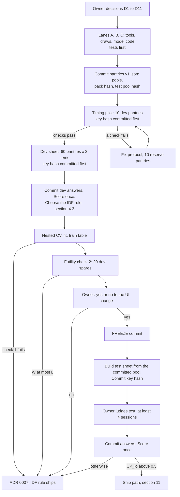

# M4 search and ranking: task-level plan

Status: Reviewed by an independent Opus reviewer: GO WITH FIXES, fixes applied 2026-11-18; owner decisions D1-D4 recorded. No M4 code exists yet.
Branch: `feat/m4-search-ranking` (from `main` at `89f57e8`). Scope source: [DEVELOPMENT_PLAN.md](../DEVELOPMENT_PLAN.md) (M4).
Rules: [ADR 0005](../decisions/0005-honest-claims-and-eval-reset.md), [JUDGING_PROTOCOL.md](../JUDGING_PROTOCOL.md). Labels: MEASURED, ESTIMATE, HYPOTHESIS.
Shape: [the M2 plan](2026-11-03-m2-eval-baseline.md).

**Goal:** find the best honest ranking. A person judges blind lists. A small linear model learns from the dev
judgments. The model ships only if it beats the IDF rule on fresh test pantries with a paired 95% interval
that excludes zero. Otherwise the IDF rule ships, and ADR 0007 records the evidence.

**Terms.**

- *Pantry*: a set of ingredient ids that a person has.
- *System* (or *arm*): a rule or model that orders recipes.
- *List*: the top 5 recipes of one system for one pantry.
- *Item*: one sheet entry. It shows one pantry and two lists (left and right).
- *Decided item*: an item where the judge chose a side (not a tie).
- *IDF*: inverse document frequency. The pack stores `idf = log(1 + N / df)`. `N` is the number of recipes
  (3,712). `df` is the number of recipes that list the ingredient.
- *The IDF rule*: the order that the test compares the model against. Section 4.3 defines it.
- *Gold recipe*: the recipe that a masked pantry comes from.
- *Title group*: recipes with the same normalised title (`pantries._group_key`).
- *Neutral order*: the order in which a sheet shows the 5 recipes of a list: by title (case-folded), then by id. It tells nothing about the arm.
- *BT*: Bradley-Terry model. It is logistic regression on feature differences.
- *CP interval*: the exact Clopper-Pearson binomial interval.
- *MDW*: minimum detectable win rate. It is the smallest true win rate that the test detects with 80% power.

## 0. Decisions for the owner

| # | Decision | Options | Status and choice |
| --- | --- | --- | --- |
| D1 | Who judges the primary set | (a) you; (b) you plus a friend, pooled | **DECIDED 2026-11-18: (a) you alone.** The primary result is one person's preference |
| D2 | Model form | (a) flat: the model orders all recipes with at most 2 missing lines; (b) within-group: the model only reorders inside "Ready now", "Need 1 thing" and "Need 2 things" | **DECIDED 2026-11-18: (a) flat.** Section 3. You still answer the UI question (yes or no to a "Best for tonight" view) before the freeze (step 11) |
| D3 | Test size | (a) 40, as in the plan; (b) 80; (c) 100 | **DECIDED 2026-11-18: (c) 60 dev / 100 test.** MDW falls from 0.765 to 0.67 at a 25% tie rate (section 6) |
| D4 | Second judge | (a) none; (b) a friend judges 30 test pantries | **DECIDED 2026-11-18: (a) none.** The second-judge text below stays for a later study. It is not in use |
| D5 | Gold-out rule | (a) keep the gold recipe in the lists; (b) remove the gold recipe and its title group from every list | Recommended, owner not yet objected: **(b).** MEASURED: the gold is in at least one top 5 for 58% of pantries (section 5.2) |
| D6 | Graded strength | (a) A, B or tie only; (b) also `strength` 1 (slight) or 2 (clear) | Recommended, owner not yet objected: **(b).** Used only for a sensitivity test |
| D7 | Reuse timing-pilot answers | (a) never; (b) they join dev when the protocol does not change after the pilot | Recommended, owner not yet objected: **(b).** Dev then has 70 pantries |
| D8 | Third system | (a) `idf_flat`; (b) a grouped IDF variant | Recommended, owner not yet objected: **(a) `idf_flat`.** The grouped weight variants are near-copies of `shipped` (section 4.2) |
| D9 | Futility checks before the freeze | (a) none; (b) two pre-registered checks | Recommended, owner not yet objected: **(b).** Check 1: nested-CV log-loss. Check 2: 20 dev spares judged as model against the IDF rule (about 25 min). Either may stop the test. Neither can prove a gain (section 7.5) |
| D10 | Earlier pantries in dev | (a) the 20 pilot and 40 spike pantries may enter dev; (b) they enter neither split | Recommended, owner not yet objected: **(b) neither** |
| D11 | Refinements to the shipped rule | (a) any change before dev; (b) defects only | Recommended, owner not yet objected: **(b) defects only**, in both engines, before dev judging starts |

Your time (section 9): about **7.7 h** of judging (6.2 to 9.2 h, ESTIMATE), in about **12 sessions** of at most 45 minutes over about 3 weeks.

## 1. Out of scope for M4

- Steps, servings or time as features. They are only in the text pack. A core change is a pack format bump (section 7).
- Ingredient-pair PMI or any other typicality statistic from Open Recipes. M4 needs no Open Recipes data.
- LambdaMART or any model with more than 8 features.
- Phone work and the 6x throttle target (handoff section 8). M4 only re-runs the latency script if the scan changes.
- M5 trust layer.
- Judging the IDF weight variants. They run label-free (section 4.2).
- A second judge (D4).

## 2. Facts this design rests on

All facts below are MEASURED unless marked. The design probes ran on 2026-11-18 on `build/pack` (pack-v2) with scratch
scripts. These numbers are not in a results file yet. Lane B reproduces them in `results/m4_idf_variants.json`
before anyone quotes them outside this plan.

| Fact | Value | Source |
| --- | --- | --- |
| Recipes, ingredients, staples | 3,712; 894; 4 staples (black pepper, salt, vegetable oil, water) | `load_pack("build/pack")` |
| Title groups | 3,655; 50 groups have more than one recipe; the largest has 3 | `pantries._group_key` |
| Eligible golds (total at least 3) | 3,336: 1,691 dev, 1,645 test | `build_pantries(pack, "popularity", 3, 42)`, draw 0 |
| Usable pantries after the exclusions and gold-out (at least 5 candidates) | dev 1,685; test 1,622 (all 20 pilot golds are in the test half) | probe 4 |
| Pantry size (dev, draw 0) | median 7, 10th percentile 5, 90th percentile 11 | probe 2 |
| Candidates with at most 2 missing lines, gold-out | median 128 | probe 4 |
| Identical top 5 (dev, gold-out, n = 1,685) | `shipped` vs `overlap` 2; `shipped` vs `idf_flat` 28; `idf_flat` vs `overlap` 11 | probe 2 |
| Gold in any of the 3 top-5 lists (gold kept, all 3,336 pantries) | 1,941 (58.2%). 1,938 if only pantries with at least 5 candidates count. The reviewer's 1,941 is the all-pantry count | probe 4 |
| "Ready now" has at least 5 recipes | 68.2% of dev pantries; median count 8 | probe 2 |
| Share of top-5 recipes with at most 2 needed lines | `overlap` 0.126, `idf_flat` 0.266, `shipped` 0.771 | probe 2 |
| Make-now recipes in the top 5 (mean) | `overlap` 0.84, `idf_flat` 1.31, `shipped` 3.99 | probe 2 |
| Missing counts never go down along the list (reviewer, dev, n = 1,685) | `shipped` 100%, `overlap` 37%, `idf_flat` 16% | independent reviewer |
| Needed lines per recipe | median 6, 90th percentile 12 | pack |
| Recipes with an optional line; with an unread required line | 1,223; 810 | pack |
| Run time | pack load 0.28 s; all pantries 9.5 s; 3,336 pantries times 3 arms 28.9 s | probe 1, this laptop |

Code facts (read on 2026-11-18):

- `pantrychef/engine.py` and `web/src/engine.ts`: score `M / sqrt(T)`. `M` is the IDF weight of satisfied lines. `T` is the weight of all needed lines. Order in a group: score, then fewer `total`, then id.
- The app shows one tab at a time: "Ready now", "Need 1 thing", "Need 2 things" (`web/src/Answer.tsx`). The default tab is the first tab that is not empty.
- `pantrychef/eval/arms.py` has `overlap`, `idf_flat`, `shipped` and `random`. `shipped` uses the engine key on a candidate set. It does not call `answer()`.
- `scripts/judging_sheet.py` is hard-coded: arms `("shipped", "overlap")` (line 27), `n = 20`, 4 repeats, the test split, draw 0, and fixed output paths (lines 24 to 26). It shows each list in arm order.
- `scripts/judging_score.py` scores two arms. Its power estimate uses a normal approximation.
- `pantrychef/eval/stats.py` has `paired_cluster_bootstrap`, `wilson` and `mcnemar_exact`. It has no Clopper-Pearson.
- The metric and arm registry is in `pantrychef/eval/results.py` only. `ARMS` maps an arm to a tuple of free-text feature names. There is no separate feature vocabulary. `web/scripts/result.mjs` checks labels, roles and splits but has no registry.
- `scripts/make_golden.py` builds `tests/golden/answer_cases.json` from the synthetic fixture pack (`tests/fixtures/pack`). CI has no real pack. `web/tests/parity.test.ts` checks scores within 1e-9 (line 30), order and counts exactly.
- `scikit-learn` is in the `recommend` extra and `scipy` in the `substitution` extra. `uv sync --all-extras` installs both.
- `.gitattributes` sets `* text=auto eol=lf`. `.gitignore` ignores `*.csv`, with an exception for the spike answers (`!data/eval/graph_spike/*.csv`, line 37). `build/` is ignored.
- `data/eval/graph_spike/pantries.v1.json`: 40 pantries. 20 (`pilot01` to `pilot20`) are the M2 pilot pantries with their `source_recipe_id`. 20 (`new01` to `new20`) are model-written name lists with no gold.

## 3. The model form (D2, decided: flat)

The judge sees a list of 5. The product shows tabs. The two must match, or the test does not test the product.

- **Within-group (b).** The model reorders inside each tab. No UI change. It can reorder the whole "Ready now" group (median 8 recipes, MEASURED). But 77% of the shipped top 5 are short recipes (at most 2 needed lines). HYPOTHESIS: a within-group model has less room for a gain than a flat one.
- **Flat (a), decided.** The model orders all candidates with at most 2 missing lines in one list. It can put a substantial one-away dish above a two-line make-now dish. The M2 model judges both said they would cook from `overlap` lists more often (0.95 against 0.80 and 0.85, `results/m2_judging_pilot.json`). `overlap` is flat. This hints that the flat form matters (HYPOTHESIS; model judges, n = 20).

If the flat model ships, the app needs one change: a first view, "Best for tonight", in model order, with the missing lines shown. The tabs stay as filters.
You say yes or no to that UI change **before the freeze** (step 11). A veto after the test would be a forking path. If you say no, the test does not run, and ADR 0007 records why the IDF rule ships.

The ranking key of the model is `(-f(r), total, recipe_id)`. `f(r)` is the linear score (section 7).
The candidate set is the same for every system: recipes with `have >= 1` and at most 2 missing lines, after gold-out.

## 4. The three dev systems and the IDF rule

### 4.1 Dev systems (D8)

| System | Order key | Why it is here |
| --- | --- | --- |
| `overlap` | `-have, total, id` | The no-ML baseline (CLAUDE.md). It is flat |
| `shipped` | `missing, -score, total, id` | The product today. The default IDF rule |
| `idf_flat` | `-score, total, id` | IDF without groups. With `shipped`, it isolates the effect of grouping. With `overlap`, it isolates the effect of IDF |

Each dev pantry gives 3 items: `shipped`–`overlap`, `shipped`–`idf_flat`, `idf_flat`–`overlap`.
All three systems exist and are in the `ARMS` registry. They differ on almost every pantry (section 2).
They also spread the list features that the model uses (missing count, length, IDF mass), so the BT fit has signal.
The arm decides which 5 recipes are in a list. The sheet shows them in neutral order (section 8.1).

### 4.2 IDF variants run label-free

The plan asks to run the IDF variants. MEASURED on 1,685 dev pantries (all usable dev pantries, gold-out). Each variant uses the shipped grouping, so only the weight or the normalisation changes.

| Variant | Weight or score | Identical top 5 | Mean shared of 5 |
| --- | --- | --- | --- |
| `idf_smooth` | `log((N+1)/(df+1)) + 1` | 0.805 | 0.980 |
| `idf_lucene` | `log(1 + (N - df + 0.5)/(df + 0.5))` | 0.822 | 0.984 |
| `shipped_b0` | `M` (no length normalisation) | 0.776 | 0.959 |
| `shipped_missmass` | missing, then missing mass, then score | 0.717 | 0.909 |
| `shipped_b1` | `M / T` (share of mass held) | 0.077 | 0.551 |
| `grouped_overlap` | missing, then `have` | 0.120 | 0.766 |

Reading:

- The shipped IDF is `log(1 + N/df)`. It is always positive. The "negative IDF" problem of plain Robertson-Sparck Jones IDF does not apply. The Lucene form is almost the same function.
- The weight variants (`idf_smooth`, `idf_lucene`, `shipped_b0`, `shipped_missmass`) are near-copies of `shipped` in the top 5. A judge would see the same list most of the time. Judging them wastes your time.
- `shipped_b1` differs, because every make-now recipe scores 1.0, so the tie-break (fewer lines) puts the shortest recipes first. HYPOTHESIS: it loses.
- The linear model has `score`, `total_c` and `miss_frac` as features. It can learn any length normalisation that the judge prefers. So the model covers the `b` variants.

Rule: Lane B runs every variant above on all usable dev pantries and writes `results/m4_idf_variants.json` (metric `top5_agreement`, role `sanity`). No variant is judged. No variant is selected. This is the "run the IDF variants" deliverable.

### 4.3 The IDF rule for the test (pre-registered)

1. After all dev answers are committed, score the `idf_flat`–`shipped` items once.
2. Let `W` be the dev pantries where `idf_flat` won and `L` the pantries where `shipped` won. Ties drop out.
3. If the CP 95% lower bound of `W / (W + L)` is above 0.5, the IDF rule is `idf_flat`. Otherwise it is `shipped`.
4. If `overlap` beats the chosen IDF rule on dev by the same test, report it in `results/m4_dev_pairs.json` and in ADR 0007. Take no other action. The IDF rule stays the comparator (ADR 0005).

This rule uses hand judgments only. A hand judgment reads no model feature, so it may select (`assert_selectable`).
It runs on dev. The test never selects anything except the ship decision.

## 5. Pantries, splits and exclusions

### 5.1 Generator

Use the existing generator. Do not write a new one.
`build_pantries(pack, "popularity", d=3, seed=42)`, draw 0. It masks a quarter of the needed lines of a gold recipe (`mask_count`),
removes every option id of a masked line, and adds 3 extra ingredients drawn by document frequency.

Why it is good enough:

- It is the generator of the M2 pilot, so the protocol checks carry over.
- The pantries are small and plausible: median 7 items (MEASURED).
- The popular extras look like a normal kitchen.

Limits (written into the results files):

- A real pantry is not built from one recipe. HYPOTHESIS: this flatters any system that finds a near-complete recipe. Gold-out (5.2) removes the strongest case.
- The popularity sampler draws by `df`. IDF gives popular items little weight, so the extras hurt `overlap` more than IDF systems (M2 finding). `shipped`, `idf_flat` and the model all use IDF. HYPOTHESIS: the bias is about the same for the model and the IDF rule, so it does not bias the model-versus-rule test much. It is not measured.

Rejected: the 20 model-written spike pantries as a second generator. They are more varied, but they come from a model and they mix generators across splits.

### 5.2 Gold-out rule (D5)

For each pantry, remove the gold recipe and every recipe in its title group from the candidate set of every system, before the top 5.
Reason: with the gold kept, the gold is in a top-5 list for 58% of pantries (1,941 of 3,336, MEASURED). A judge then often prefers the list that holds it, because the pantry was built for it. A model that learns this learns the recovery task, which leaks (ADR 0005).

### 5.3 Splits and the committed pools

- Dev pantries come only from dev-half golds (`assign_splits`, seed 42). Test pantries come only from test-half golds. The split is by title group, so no title group gives a pantry to both splits.
- A recipe can appear in the lists of both splits. That is not a label leak: the model has no per-recipe parameter. It only reads features.
- Exclusions from both splits: the 20 pilot gold ids (`source_recipe_id` in the spike `pantries.v1.json`) and their title groups. The 20 written spike pantries have no gold, so they cannot collide. They also stay out of M4 (D10).
- Usable means: at least 5 candidates after gold-out.
- Order inside each split: `sha256(f"42:m4:{gold_id}")`. The salt `m4` differs from the pilot salt `judge`.
- Dev pool, in that order: timing pilot (10), dev (60), futility spares (20), reserve (10). The reserve replaces the pilot pantries if the pilot fails and must run again (8.2).
- Test pool: **every** usable test pantry, in that order (1,622 pantries, MEASURED). The whole ordered pool is committed and hashed at step 3, before any judging and before any model exists.
- The test sheet takes the first 100 pantries of the pool whose model list differs from the IDF-rule list. This gate is label-free. It needs no change after the fact, because the pool is far larger than 100.
- `pantry_id = f"m4-{split}-{gold_id}"`. Each pantry also stores `sha256` of its sorted ids, so two golds that give the same pantry are caught.
- Step 3 also pins the `sha256` of `build/pack/core.v2.json.gz` in `pantries.v1.json`. `build/` is ignored by git, so this hash is the only proof of which pack made the lists.

### 5.4 The test that proves test pantries are absent from training

`tests/eval/test_m4_splits.py::test_test_pantries_absent_from_training`. It runs in CI and in a fresh clone. It reads committed files only. It needs no pack and no private key.

- Inputs: the committed test pool in `data/eval/m4/pantries.v1.json`; the committed training table `data/eval/m4/train_table.v1.json` (written at step 8: `pantry_id`, `item_id`, the arm pair, `y`, the pair feature `z`; no recipe text); the `trained_on` block of `web/src/rank_model.v1.json`.
- Assertions:
  1. No test `pantry_id`, gold id, title group key or content hash appears in the training table.
  2. The `sha256` of the sorted training pantry ids equals `trained_on.pantries_sha256` in the weights file.
  3. No pilot gold id or its title group appears in any M4 pantry.
  4. Dev and test title groups are disjoint.
  5. The futility answers (7.5) are not in the training table.
- A second test runs the same check on a tiny fixture with a planted test pantry and expects a failure.
- Before step 8 the files do not exist. The test then skips with a clear reason. After step 8 it must pass.

## 6. Power (re-derived)

The Designer computed this table with a scratch script (scipy `binom`, cross-checked against `binomtest(...).proportion_ci("exact")`).
Lane A rebuilds it with pure-Python `stats.py` code and pins three rows in a test (`test_power_table`), so the numbers live in the repo.
Method: exact binomial. The test passes when the CP 95% lower bound of the win rate among decided items is above 0.5.
That equals a one-sided exact binomial `p <= 0.025`. Power uses a random number of decided items, `Binomial(n, 1 - tie_rate)`,
because you cannot know the tie count in advance. ESTIMATE for every row. The tie rates come from the M2 model-judge pilot (0 and 0.25), so they are guesses for a person.
MDW values are rounded up to the next 0.005.

| Test pantries | Tie rate | Wins needed (at expected decided) | Power at true 0.65 | 0.70 | 0.75 | MDW (80%) |
| --- | --- | --- | --- | --- | --- | --- |
| 40 | 0 | 27/40 | 0.44 | 0.70 | 0.90 | 0.725 |
| 40 | 0.25 | 21/30 | 0.30 | 0.52 | 0.75 | 0.765 |
| 40 | 0.40 | 18/24 | 0.24 | 0.42 | 0.64 | 0.795 |
| 60 | 0.25 | 30/45 | 0.47 | 0.74 | 0.92 | 0.715 |
| 80 | 0.25 | 39/60 | 0.60 | 0.86 | 0.98 | 0.685 |
| **100 (decided)** | 0 | 61/100 | 0.83 | 0.98 | 1.00 | 0.650 |
| **100 (decided)** | 0.25 | 47/75 | 0.71 | 0.93 | 0.99 | 0.670 |
| **100 (decided)** | 0.40 | 39/60 | 0.60 | 0.86 | 0.98 | 0.690 |

Power is a sawtooth in `n`: adding one pantry can lower it a little. With no ties, power first reaches 80% at 49 pantries for a true 0.70 and stays at or above 80% from 54. For a true 0.65 the numbers are 90 and 97. At a 25% tie rate, both numbers are 69 (true 0.70) and 122 (true 0.65). True 0.60 needs 199 to 272 pantries.
These match the briefing to the stated digits. New here: the MDW column, power with a random tie count, and the sawtooth.

**What 100 test pantries can and cannot show.** With 100 pantries, the test detects a true win rate of 0.65 to 0.69 with 80% power, depending on ties.
It cannot reliably detect a true win rate below about 0.65. A null result means "no gain of that size". It does not mean "no gain".
For comparison, the plan's 40 pantries would detect only 0.725 to 0.795.

Options that were considered (D3 and D4 are now decided):

| Option | Cost (ESTIMATE) | MDW at 25% ties | Gives | Does not give |
| --- | --- | --- | --- | --- |
| (i) 60 dev / 40 test, as planned | 0 | 0.765 | The plan as written | Power for a moderate gain |
| (ii) 40 dev / 60 test | 0 h net; dev loses 60 items | 0.715 | More test power | Training data: 20 fewer dev pantries |
| **(iii) 60 dev / 100 test (chosen)** | +60 items, about +80 min | 0.670 | Power for a moderate gain. Dev stays whole | It changes the plan's "100 pantries" to 160 judged pantries, plus the pilot and the futility spares |
| (iv) Second judge on the same test pantries (not in use, D4) | about 40 min of a friend's time | unchanged | Agreement data (raw, Cohen kappa, Gwet AC1), a second taste | Independent pantries. Two judges on one pantry are correlated, so the primary n does not grow |
| (v) Graded strength, Wilcoxon signed-rank (D6) | about 5 s per item | HYPOTHESIS: a little lower | A sensitivity test | A change to the primary test |

### 6.1 Pre-registered analysis (copied into the freeze, section 10)

- **Primary.** Model against the IDF rule on test, one item per pantry. `W` = model wins, `L` = rule wins, `T` = ties. Win rate `p = W / (W + L)`.
  The two-sided 95% CP interval on `p`. **Gain** = `p - 0.5`, with the interval `[CP_lo - 0.5, CP_hi - 0.5]`.
  Exact two-sided binomial p-value as a second view of the same test.
- **Ship rule.** The model ships only when `CP_lo > 0.5` (the gain interval excludes zero) and you said yes to the UI change before the freeze. Otherwise the IDF rule ships. One look. No early stop. No re-test on new pantries after a failure (a new attempt needs a new plan and new pantries, and it is reported as a second attempt).
- **Ties.** Excluded from the primary. Reported: the tie rate; the win rate with each tie as half (descriptive only); the worst case with every tie given to the rule (`W` against `L + T`).
- **Repeats.** Only the first showing of a pantry counts. Repeats give self-consistency.
- **Descriptive numbers (not tests).** Net preference `(W - L) / n`. The win rate in each test session.
- **Arm guess.** Each test item has `arm_guess` (section 8.1). Report: guess accuracy among items with a left or right guess, with a CP interval; the share of `unsure`; the model win rate among items where the guess was right, wrong and `unsure`. If guess accuracy is high and the win rate differs between right and wrong guesses, the result says the blinding was weak. The ship rule does not change.
- **Secondary (not part of the ship rule).**
  1. Would-cook: per pantry, `b` = model yes and rule no, `c` = the reverse. Mean paired difference `(b - c) / n` and exact McNemar (`stats.mcnemar_exact`). The CP interval on `b / (b + c)`.
  2. Strength: Wilcoxon signed-rank on scores from -2 to 2 (rule clear win = -2, tie = 0, model clear win = 2).
  3. Drift probes (section 8.3): agreement between your dev and test answers on the same items.
- **Not used.** Cluster bootstrap. At this n it is anti-conservative: the interval is too narrow. One item per pantry also makes it unnecessary.
- **Report even if bad.** A null or negative result goes into ADR 0007 and EVALUATION.md with the same detail.

## 7. Features and the model

### 7.1 Features (at most 8)

Rules for every feature:

- It is computed at run time from what pack core already has. No pack format change.
- It uses only `+`, `-`, `*`, `/` and `sqrt` on stored numbers. These are correctly rounded in IEEE 754, so Python and TypeScript give the same bits. `log` and `exp` are not (V8 and the C library can differ by one unit in the last place), so a run-time feature never calls them.
- It varies across recipes inside one pantry. A value that is the same for every recipe of a pantry adds nothing to a ranking. (So `have / pantry_size` is out: inside one pantry it is a fixed multiple of `have`.)
- Its `df` source is the pack-v2 core `idf` (all 3,712 Wikibooks recipes). The product uses the same numbers. No Open Recipes data is needed.

| # | Feature | Definition | Per pantry or per recipe | Why |
| --- | --- | --- | --- | --- |
| 1 | `score` | `M / sqrt(T)` (the shipped score) | per pantry | The IDF signal |
| 2 | `missing` | missing needed lines (0, 1, 2) | per pantry | The trip length. The flat form must learn this trade-off |
| 3 | `miss_frac` | `(T - M) / T` | per pantry | How much of the dish's rare part you lack |
| 4 | `unread_missing` | missing lines that the parser could not read (0 to 2) | per pantry | "Check this line" is a cost to the cook |
| 5 | `total_c` | `min(total, 12)` | per recipe | Length prior. 12 is the 90th percentile (MEASURED) |
| 6 | `short` | 1 when `total <= 2`, else 0 | per recipe | Structure signal: a very short recipe. Fixed before any judgment |
| 7 | `optional_c` | `min(optional lines, 3)` | per recipe | Structure signal: a fuller recipe page (HYPOTHESIS) |
| 8 | `mean_w` | `T / total` (mean line weight) | per recipe | Typicality: a dish of common ingredients has a low mean weight (HYPOTHESIS) |

Not included, and why:

- Step count and step length (structure). They need the text pack in the scan or a core change, which is a pack bump (`PACK_FORMAT`, `build.py`, `types.ts`, parity, a new release). Lines, optional lines and unread lines give structure signals without that.
- Matched fraction `M / T`. It equals `1 - miss_frac`. Both would double count.
- Ingredient-pair PMI. It needs counts from a larger corpus (Open Recipes, derived numbers only), smoothing, a pack change and a licence entry. Counts from the Wikibooks pack itself would include the gold recipe's own row. The evidence for it is weak (Researcher B, unverified). Defer to a later milestone.
- `have / pantry_size`. See the rules above.

Collinearity: `score`, `miss_frac` and `mean_w` all read the same weights. L2 shrinkage handles this. The weights are not read as effect sizes.

### 7.2 Latency

The engine already computes `have`, `M`, `T` and the missing lines for each candidate. Features 5 to 8 depend only on the recipe and the staples, so `prepared()` computes them once per staple set.
Per answer, the model adds a dot product of 8 numbers for each candidate (median 128 candidates after gold-out, MEASURED) and one sort. ESTIMATE: under 0.1 ms on a laptop. The scan of 3,712 recipes is unchanged.
If the model ships, Lane E re-runs `node web/scripts/latency-ui.mjs` (6x throttle) and the real-phone run. Pass: no cell gets slower beyond its run-to-run noise. The real phone must still pass 200 ms in all 11 cells.

### 7.3 From list judgments to a per-recipe scorer

- Per-recipe score: `f(r) = w . x(r)`. `x(r)` is the 8-feature vector.
- List feature: the mean of `x(r)` over the 5 recipes of the list. The sheet shows the 5 in neutral order, so the judge judges a set of choices. The mean treats all 5 the same, which matches. Recipes in both lists cancel out, so only the differing members carry signal.
- Pair feature: `z = mean_x(left) - mean_x(right)`.
- Model: `P(left preferred) = sigmoid(w . z)`. This is BT with a linear strength.
- No intercept. Add each decided item twice, as `(z, 1)` and `(-z, 0)`. This makes the fit symmetric, so side and arm order cannot leak in.
- Loss: logistic loss with L2 (`sklearn.linear_model.LogisticRegression(fit_intercept=False)`). Features are standardised on the training fold. At freeze, the standardisation is folded into raw weights, so the browser needs no means.
- Ties: dropped from the fit. The tie rate is reported. Davidson's tie model is rejected: more code for an expected tie rate of 0 to 25%.
- Strength: not used in the fit. It is a test sensitivity only.
- Would-cook: not used in the fit. It is a secondary endpoint. HYPOTHESIS: it might add power as a paired measure, but McNemar uses only the discordant pantries, so it rarely beats the sign test.
- Model-judge answers and futility answers never enter the fit. Training on model-judge answers would make the ranker a function of an LLM, which ADR 0002 rules out for core features.

### 7.4 Nested cross-validation

- Data: about 210 dev items (70 pantries times 3, with D7), about 160 decided at a 25% tie rate (ESTIMATE). That is about 20 decided items per weight.
- Groups: a pantry is a group. Its 3 items never split across folds.
- Outer loop: `GroupKFold(5)`. Inner loop: `GroupKFold(4)` on the outer training part.
- Inner choice: `C` in {0.01, 0.03, 0.1, 0.3, 1} and the feature set in {F1 = `score`, `missing`; F2 = F1 + `total_c`, `short`; F3 = all 8}. Find the lowest mean held-out log-loss and its standard error across inner folds. Then apply the **one-standard-error rule**: take the smallest feature set, and inside it the smallest `C`, whose mean log-loss is within one standard error of the lowest.
- Outer result: held-out log-loss and pair accuracy of the whole procedure, against chance (0.693, 0.5) and against F1 alone. Label: ESTIMATE. It is not a test result.
- Final model: run the inner choice on all dev items, fit, fold the standardisation, write the weights file and `data/eval/m4/train_table.v1.json`.
- The CV metric `cv_pairwise_logloss` reads only hand labels as ground truth. It selects `C` and the feature set inside dev. It is registered with role `selection`.

Known gap: no judge sees a model list before the futility check (7.5). The model extrapolates from lists of the three dev systems. The futility check gives a first, small look at that. The test is the real check.

### 7.5 Futility checks (D9, pre-registered)

Futility checks may stop the test. They can never prove a gain, and they never change the weights.

**Check 1 (label-only, after step 8).** If the outer nested-CV log-loss is not below 0.693 (chance), stop: no test, the IDF rule ships, ADR 0007 says why.
This is a weak gate. The independent reviewer estimated, on synthetic data, that it passes 27% of runs with no signal and fails 54% of runs with a weak real signal (ESTIMATE). So it is only a first gate.

**Check 2 (20 dev spares, after check 1 passes, before the freeze).**

- Build a sheet of the 20 futility-spare dev pantries: model list against IDF-rule list, neutral order, sides random, no repeats. Commit `key_sha256.futility.txt` before you answer. About 25 minutes, one session.
- Stop rule: let `W` be model wins and `L` rule wins among the decided items. **Stop when `W <= L`** (including no decided items). Then the test does not run, the IDF rule ships, and ADR 0007 records both checks.
- Stop probabilities (ESTIMATE, exact binomial, random tie count): at a true model win rate of 0.50, it stops 55% to 59% of the time; at 0.65, 12% to 14%; at 0.70, 5% to 7%; at 0.75, 1% to 3% (tie rates 0 to 0.25).
- It also measures the real tie rate of a model-against-rule item. The result goes into `results/m4_futility.json`. Section 6 is not recomputed from it: the test size is fixed.
- The futility answers never enter training, and the weights do not change after check 2. If they changed, the freeze would be exploratory.

A label-free check also runs at step 3 of the test sheet: the 100 test pantries are taken only where the two lists differ (5.3).

### 7.6 Weights file

`web/src/rank_model.v1.json`, one file for both engines (Vite bundles it; Python reads it).

```json
{
  "version": 1,
  "features": ["score", "missing", "miss_frac", "unread_missing", "total_c", "short", "optional_c", "mean_w"],
  "weights": [0.0, 0.0, 0.0, 0.0, 0.0, 0.0, 0.0, 0.0],
  "feature_set": "F3",
  "C": 0.1,
  "standardisation": {"mean": [], "sd": []},
  "trained_on": {"pantries_sha256": "", "train_table_sha256": "", "n_pantries": 70, "n_items": 210, "n_decided": 160},
  "cv": {"outer_logloss": 0.0, "outer_accuracy": 0.0},
  "comparator": "shipped",
  "commit": "",
  "licence": "MIT (derived from the owner's judgments and pack-v2 numbers)"
}
```

The numbers above are placeholders. Weights of features outside the chosen set are 0. `standardisation` is kept for audit only.

## 8. Judging

### 8.1 Who, how, and blinding

- You judge every primary item (D1). One person's preference is the claim. The results files and the docs say so.
- Sessions: at most 45 minutes, on different days. Re-read the written rubric at the start of each session.
- The rubric stays as in `docs/JUDGING_PROTOCOL.md`. One addition: after the choice, write `strength` 1 (slight) or 2 (clear). For a tie, leave it blank.
- **Neutral order.** Every sheet (pilot, dev, futility, test) shows the 5 recipes of each list in neutral order: by title, case-folded, then by id. The arm decides which 5 recipes are in the list. It never decides their order on the sheet.
  Why: MEASURED by the reviewer on 1,685 dev pantries, missing counts never go down along a `shipped` list in 100% of lists (37% for `overlap`, 16% for `idf_flat`). You built the product, so you would know that pattern.
- **What neutral order does not hide.** A `shipped` list still holds about 4 make-now recipes on average (`overlap` 0.84, `idf_flat` 1.31, MEASURED). You can see "nothing to buy" under most titles. So the blinding is reduced, not removed. The test measures how much (next point).
- **Arm guess on the test sheet.** After the choice, each test item asks: "Which list do you think the new model made?" `left`, `right` or `unsure`. When the comparator is `shipped`, this is the same as asking which list is today's app. Section 6.1 says how it is reported.
- **Limit of neutral order.** The sheet tests which 5 recipes the model picks, not the order inside the 5. The flat "Best for tonight" view would show model order. So a passed test supports the model's top-5 set. It says nothing about the order inside the top 5. The results files and ADR 0007 say this plainly.
- **Keep yourself blind.** Until the test answers are committed, do not open: `data/interim/judging_key.m4-*.json`, `results/m4_dev_pairs.json`, `results/m4_cv.json`, `results/m4_futility.json`, `data/eval/m4/train_table.v1.json`, or `web/src/rank_model.v1.json`. The lead tells you only "go" or "stop" after each gate. The lead commits these files; do not read their diffs.
- Sides are random. No sheet shows an arm name. The three items of one dev pantry sit at least 3 places apart.
- Model judges may dry-run the tools (sheet to scorer) before you start. Their answers are labelled `judge_model`, use the metric `pilot_pairwise_win_rate` (role `sanity`) and never enter training, comparator choice, futility or the test.

### 8.2 Timing pilot (protocol check 3)

- Size: 10 dev pantries, 3 items each, plus 4 unmarked repeats: 34 items. One session, about 43 minutes (ESTIMATE at 75 s).
- Who: you. A model cannot time itself.
- Measured: seconds per item (stopwatch, in the `seconds` column), choice, strength, would-cook.
- Pass rules (the four protocol checks): median under 90 s; tie rate at most 60%; at least 3 of 4 repeats give the same outcome; the scorer prints the exact power table for the observed tie rate.
- If a check fails: change the rubric or the list length, then pilot the 10 reserve pantries. The failed pilot answers never join dev.
- If all pass and nothing changed: the 10 pantries join dev (D7).

### 8.3 Changes to the judging tools

`scripts/judging_sheet.py` (keep the defaults, so the M2 pilot key still reproduces):

- `--arms` (2 or 3 names). Three names make the 3 pairs per pantry.
- `--n`, `--repeats`, `--min-gap`.
- `--pantries FILE --pool pilot|dev|futility|reserve|test --take N`: read pantries from the committed `data/eval/m4/pantries.v1.json` instead of drawing them. Refuse when the sha256 of `build/pack/core.v2.json.gz` differs from the hash pinned in that file.
- `--name NAME`: sheet `data/eval/m4/sheet.NAME.v1.json`, key `data/interim/judging_key.m4-NAME.v1.json`, hash `data/eval/m4/key_sha256.NAME.txt`.
- `--neutral-order` (default on for M4 names, off for the old pilot name, so the M2 key hash still reproduces).
- `--gold-out` (default on for M4 names, off for the old pilot name).
- `--model web/src/rank_model.v1.json` for the futility and test sheets. For the test, the script refuses unless `data/eval/m4/freeze.v1.json` is committed, the tree is clean, and every hash in it matches (including the pack hash).
- Test selection: walk the committed test pool in order; skip a pantry when the two lists are identical; stop at 100. Record skips in the key.
- `--arm-guess` (test sheet only): adds the `arm_guess` column to the answer template.
- Drift probes: `--probes 4` re-shows 4 dev items in the test sheet. The key marks them. They never count in the primary.

`scripts/judging_score.py`:

- Any arm names from the key. Per pair type: W, L, T, net preference, CP interval, exact p.
- `strength` column (optional; blank for ties) and `arm_guess` column (test only).
- Per-session win rates, when the answers carry a `session` column.
- Replace the normal-approximation power with the exact method of section 6 (keep the old function for the M2 tests, or update those tests with hand values).
- A `--test` mode that applies section 6.1 and writes the result file.

`pantrychef/eval/stats.py`: add `clopper_pearson(k, n, level=0.95)` and `sign_test(k, n)` in pure Python (`math.comb`, bisection). No new runtime dependency.

`.gitignore`: add `!data/eval/m4/*.csv`, next to the spike exception on line 37, so the answers commit without `git add -f`.

Tests to add in `tests/test_judging.py`:

- 3 arms give 3 items per pantry, every unordered pair once.
- Items of one dev pantry sit at least `min_gap` apart.
- Neutral order: every M4 list is sorted by case-folded title, then id. Two arms with the same 5 recipes give the same displayed list.
- Gold-out: no list holds the gold or its title group.
- The old pilot call still gives the committed pilot key hash.
- A test sheet refuses without a committed freeze, when a frozen hash differs, and when the pack hash differs.
- The scorer: hand-computed W, L, T and CP for a 3-arm key; a strength column; blank strength on a tie is fine, strength on a tie fails; arm-guess accuracy and the split win rates on a hand-made key.
- `clopper_pearson(27, 40)` gives 0.5087 to 0.8143 (4 decimals); `clopper_pearson(20, 30)` lower bound is 0.4719.

## 9. Time and the 1,500 judgments

### 9.1 Hours (ESTIMATE)

Assumption: 60 to 90 s per item, 75 s central. Test items need about 5 s more for `arm_guess` (65 to 95 s, 80 s central). The pilot measures the real value. Then this table is redone.
Sessions are at most 45 minutes. No second judge (D4).

| Block | Items | Central | Range | Sessions |
| --- | --- | --- | --- | --- |
| Timing pilot: 10 pantries times 3, plus 4 repeats | 34 | 43 min | 34 to 51 min | 1 |
| Dev: 60 pantries times 3, plus 18 repeats | 198 | 4.1 h | 3.3 to 5.0 h | 6 |
| Futility check 2: 20 dev spares, model against rule | 20 | 25 min | 20 to 30 min | 1 |
| Test: 100 pantries, plus 6 repeats and 4 drift probes | 110 | 2.4 h | 2.0 to 2.9 h | 4 |
| **Total** | **362** | **7.7 h** | **6.2 to 9.2 h** | **12** |

The test alone is at least 4 sessions (110 items at 80 s is about 147 minutes). Test sessions start at least 2 days after the last dev session.
If the pilot fails once, add one more pilot session (about 43 minutes) with the reserve pantries.

### 9.2 Where "about 1,500 judgments" comes from

The plan says "up to about 1,500". It is a ceiling, not a target. Count of answers in this design (first showings only):

- Pair choices: 30 (pilot) + 180 (dev) + 20 (futility) + 100 (test) = 330.
- Would-cook answers: 2 per pair choice, so 660.
- Strength answers: about 250 (decided items only, ESTIMATE).
- Arm guesses: 100.
- Total: about 1,340 answers, plus repeats and probes.

A per-recipe tick ("would I cook this dish?") on every recipe would add about 5 per list and pass 1,500. It would give direct per-recipe labels.
It also adds about 30 s per item, which threatens the 90 s line. Not recommended for M4. 1,500 is not needed.

## 10. Order of work and the freeze



All of this is planned. Nothing in it runs today.

Exact order, with where each hash goes:

1. Owner decisions (D1 to D4 are decided). The Reviewer and the Statistician have reviewed this plan (R1).
2. Code lanes A, B, C, tests first (section 13).
3. Draw: `scripts/m4_rank.py pantries` writes `data/eval/m4/pantries.v1.json`: the dev pool (pilot 10, dev 60, futility 20, reserve 10), the whole ordered test pool, and the sha256 of `build/pack/core.v2.json.gz`. It writes the sha256 of the test pool to `data/eval/m4/test_pantries_sha256.txt`. **Commit both before any judging.** The test pool does not depend on any model, so it is fixed first.
4. Optional dry run with a model judge on the pilot sheet (labelled, discarded).
5. Timing pilot sheet. Commit `key_sha256.pilot.txt` before you answer. Answer. Commit `answers.pilot.v1.csv`. Score.
6. Dev sheet (if the pilot passed). Commit `key_sha256.dev.txt` before you answer. Answer in about 6 sessions. Commit `answers.dev.v1.csv`. The lead scores once and writes the dev result files. You do not read them (8.1).
7. Apply section 4.3. Write the chosen IDF rule into `results/m4_dev_pairs.json`.
8. `scripts/m4_rank.py train`: nested CV, check 1, final fit, `web/src/rank_model.v1.json`, `data/eval/m4/train_table.v1.json`, `results/m4_cv.json`. Commit them.
9. Futility check 2 (7.5): sheet from the step-8 weights, `key_sha256.futility.txt` committed first, one session, `answers.futility.v1.csv` committed, scored into `results/m4_futility.json`. The lead tells you "go" or "stop" only.
10. Statistician review of steps 6 to 9 (R3).
11. You say yes or no to the "Best for tonight" UI change. The lead records the answer in `data/eval/m4/ui_decision.v1.json` and commits it. No means stop (section 3).
12. `scripts/m4_rank.py freeze` on a clean tree. It copies section 6.1 of this plan into `data/eval/m4/analysis_plan.v1.md` and writes `data/eval/m4/freeze.v1.json` with the sha256 of:
    - the weights file `web/src/rank_model.v1.json`;
    - `data/eval/m4/train_table.v1.json`;
    - `data/eval/m4/analysis_plan.v1.md`;
    - the test pool (`test_pantries_sha256.txt` value) and `pantries.v1.json`;
    - `build/pack/core.v2.json.gz` (must equal the hash pinned at step 3);
    - `data/eval/m4/ui_decision.v1.json`;
    - the scoring and list code: `pantrychef/rank.py`, `pantrychef/engine.py`, `pantrychef/eval/pairwise.py`, `pantrychef/eval/stats.py`, `pantrychef/eval/arms.py`, `pantrychef/eval/pantries.py`, `pantrychef/eval/results.py` (it holds `_commits` after task A5), `scripts/judging_sheet.py`, `scripts/judging_score.py`, `scripts/m4_rank.py`;
    - and the comparator name, `n_test` (100), the seed and the commit.
    **This is the one freeze commit.**
13. Test sheet from the committed pool (5.3). Commit `key_sha256.test.txt` before you answer.
14. Answer in at least 4 sessions on different days. Commit `answers.test.v1.csv`.
15. `scripts/m4_rank.py score`. It stops unless: every frozen file matches its hash, including the pack; freeze, key hash and answers each have exactly one commit, in that order (the `_commits` check of `scripts/graph_spike.py`, moved into `results.py`); the key on disk matches the committed hash. It writes `results/m4_test.json`.
16. Statistician and Reviewer check the analysis against `analysis_plan.v1.md` (R4).
17. Ship path or ADR 0007.

A broken freeze (any frozen file changed after step 12) makes the run exploratory. A new attempt needs new test pantries, a new freeze and a note in ADR 0007.

## 11. The ship path

### 11.1 If the model ships

- `pantrychef/rank.py`: `features(...)` and `model_order(...)`. The eval code and the engine both call it. One definition.
- `web/src/rank.ts`: the twin. Same feature order, same summation order (line order), same tie-break.
- Engine: `answer()` keeps its groups and adds a `best` list in model order (D2 flat). Both engines change in one commit.
  `make_golden.py` writes answers with `asdict`, so the new field changes `tests/golden/answer_cases.json`. Regenerate it in the same commit.
- UI (you said yes at step 11): a first view "Best for tonight" from `best`. Tabs stay. Playwright and a11y tests pass. WCAG 2.2 and 44 px targets.
- Parity: `scripts/make_golden.py` adds `tests/golden/rank_cases.json` from the **synthetic fixture pack**, as for `answer_cases.json`, because CI has no real pack. At least 50 pantries: top 10 ids and scores. `web/tests/parity.test.ts` checks ids exactly and scores within 1e-9 (the current tolerance).
- Pinned ordering: `tests/golden/rank_pinned.json` holds 5 hand-checked fixture-pack pantries with their expected top 5 ids. pytest and Vitest both check it in CI. A second pinned file on the real pack runs locally and skips when `build/pack` is absent, as the bare-pepper tests do. A change to the order fails until a person re-pins it.
- Ordering tests: the key is total and deterministic; ties fall to `total`, then id (bytewise); a weight of 0 for every feature except `score` reproduces `idf_flat`.
- Latency: section 7.2.
- Docs: EVALUATION.md (M4 section, MEASURED), ADR 0007 (accepted: the model ships, with the test numbers and the neutral-order limit), LICENSES.md (weights file, MIT), PROJECT_STATE.

### 11.2 If the model does not ship

- ADR 0007, "Keep the IDF rule after the M4 test". It records: W, L, T, the CP interval, the gain interval, the MDW for the n used, what a null means at that n, the arm-guess result, the dev comparator result, the CV result, both futility checks, the UI decision, and every deviation from the plan. If a futility check or the UI decision stopped the test, it says so and gives those numbers.
- The comparator stays the product order. If `idf_flat` won on dev (section 4.3), the ADR says so. The change from tabs to a flat first view is then a separate owner decision for a later milestone.
- The pinned ordering test is still added, for the shipped rule (acceptance needs it either way), on the fixture pack in CI.

### 11.3 Refinements to the shipped rule (D11)

In scope before dev judging starts: defects only, for example a wrong staple flag, or a tie-break that differs between the engines.
Each fix changes `engine.py` and `engine.ts` together, regenerates `tests/golden/answer_cases.json`, and passes parity.
After the first dev answer is committed, the shipped rule is frozen until step 15. An ordering idea after that point is a new arm for a later study.

## 12. Leakage and bias rules

| # | Leak or bias | Rule |
| --- | --- | --- |
| L1 | The pantry is built from the gold's own lines, so the gold fits it best | Gold-out (5.2) |
| L2 | Masked recovery selects a model | Never. Sanity role only. `assert_selectable` fails |
| L3 | A statistic computed from the gold's own row (`df`, PMI) | No label is computed from `df`. All features use the shipped pack `idf`, the same numbers as production. No PMI in M4. If a later feature needs counts, use leave-one-out or an external corpus |
| L4 | IDF counted twice | `M / T` is not a feature (it equals `1 - miss_frac`). L2 shrinkage for the rest |
| L5 | A function of an arm's score selects that arm | Only hand judgments select (section 4.3). `top5_agreement` describes variants and selects nothing |
| L6 | The model's features equal the metric's inputs | The selection metrics read hand labels only. Registry entries have empty `depends_on` and a justification |
| L7 | Test pantries enter training | Split by title group; whole test pool committed first; the test in 5.4, in CI |
| L8 | Tuning on test | One freeze, one look, no re-test. Futility answers never train |
| L9 | The judge remembers a dev answer on test | Test sessions start at least 2 days after the last dev session. Drift probes measure it |
| L10 | The judge recognises the arm from list order or style | Reduced: neutral order on every sheet removes the order cue. Measured: `arm_guess` on every test item, with the win rate split by right and wrong guesses. Not removed: a `shipped` list still shows more "nothing to buy" titles |
| L11 | Model-judge labels in training | Forbidden (7.3) |
| L12 | The judge sees interim results | The judge does not open the dev keys, dev results, CV results, futility results, the training table or the weights before the test answers are committed (8.1) |
| L13 | A different pack makes the lists | The pack hash is pinned at step 3 and checked by the test-sheet builder and by `score` |

## 13. File map

Create:

| Path | Purpose |
| --- | --- |
| `pantrychef/rank.py` | The 8 features and `model_order` (one definition for eval and engine) |
| `pantrychef/eval/pairwise.py` | Pair features, BT fit, nested grouped CV, one-standard-error rule, check 1, weights and training-table writer |
| `scripts/m4_rank.py` | Thin CLI: `pantries`, `variants`, `train`, `freeze`, `score` |
| `data/eval/m4/pantries.v1.json`, `test_pantries_sha256.txt` | Pools, pack hash, test-pool hash |
| `data/eval/m4/sheet.*.v1.json`, `key_sha256.*.txt`, `answers.*.v1.csv` | Sheets, key hashes, answers (pilot, dev, futility, test) |
| `data/eval/m4/train_table.v1.json` | Derived training table (no recipe text), read by the CI split test |
| `data/eval/m4/ui_decision.v1.json` | Your yes or no to the UI change, before the freeze |
| `data/eval/m4/NOTICE.md` | CC BY-SA notice for the sheets (copy of the pilot notice, adjusted) |
| `data/eval/m4/analysis_plan.v1.md`, `freeze.v1.json` | The freeze |
| `web/src/rank_model.v1.json` | The weights (written at step 8) |
| `tests/eval/test_m4_splits.py`, `test_pairwise.py`, `test_rank.py` | Splits, BT and CV, features and ordering |
| `results/m4_timing_pilot.json`, `m4_arm_overlap.json`, `m4_arm_shipped.json`, `m4_arm_idf_flat.json`, `m4_dev_pairs.json`, `m4_idf_variants.json`, `m4_cv.json`, `m4_futility.json`, `m4_arm_rank_linear.json`, `m4_test.json` | One file per judged arm, one shared file for the 6 variant arms, plus the pair, CV, futility and test files |
| `docs/decisions/0007-*.md` | The ship or no-ship decision |
| Only if the model ships: `web/src/rank.ts`, `tests/golden/rank_cases.json`, `tests/golden/rank_pinned.json` | Browser twin and parity |

Modify: `scripts/judging_sheet.py`, `scripts/judging_score.py`, `pantrychef/eval/stats.py`, `pantrychef/eval/results.py`
(registry, `_commits`), `.gitignore` (one exception line), `tests/test_judging.py`, `docs/JUDGING_PROTOCOL.md`, `docs/EVALUATION.md`, `docs/PROJECT_STATE.md`,
`docs/DEVELOPMENT_PLAN.md`, `LICENSES.md`. If the model ships: `pantrychef/engine.py`, `web/src/engine.ts`, `web/src/Answer.tsx`, `scripts/make_golden.py`, `tests/golden/answer_cases.json`.

Not touched: the pack builder, the pack format, `data/processed/`, `.codegraph/`, `.claude/worktrees/`, `CODEX_HANDOFF.md`, `TestRun.md`, `scratch_codex_audit_prompt.md`, `temp_pytest/`.

### 13.1 Registry additions (`pantrychef/eval/results.py`)

`ARMS` holds free-text feature names. The new names `unread` and `optional` simply appear in the new entries. No other step is needed.

Arms:

| Arm | `features_used` |
| --- | --- |
| `rank_linear` | `idf`, `have`, `total`, `unread`, `optional` |
| `idf_smooth`, `idf_lucene`, `shipped_b0`, `shipped_b1`, `shipped_missmass` | `idf`, `have`, `total`, `group` |
| `grouped_overlap` | `have`, `total`, `group` |

Metrics:

| Metric | Role | `depends_on` | Justification |
| --- | --- | --- | --- |
| `pairwise_win_rate` (exists) | selection | none | hand judgement; reused for dev, futility and test with `split` |
| `would_cook_rate` | selection | none | hand judgement; secondary endpoint |
| `pairwise_net_preference` | sanity | none | descriptive `(W - L) / n` |
| `pairwise_tie_rate` | sanity | none | |
| `judge_repeat_agreement` | sanity | none | |
| `judge_arm_guess_accuracy` | sanity | none | blinding check |
| `judge_median_seconds` | product | none | protocol cost check; never selects |
| `cv_pairwise_logloss` | selection | none | held-out hand labels, grouped by pantry; selects C and the feature set inside dev only |
| `cv_pairwise_accuracy` | sanity | none | |
| `top5_agreement` | sanity | `idf`, `have`, `total`, `group` | describes variants; never selects |
| `judge_agreement_ac1`, `judge_agreement_kappa` | sanity | none | second judge; not in use (D4) |

Each result file has `commit`, `dirty`, `dirty_paths`, `config` (arms, `n`, gold-out, neutral order, sampler, `d`, comparator, feature set, `C`, pack hash),
`seed` (42), `corpus_fingerprint` (from pack info), `command` and `label` (MEASURED for counts and intervals, ESTIMATE for CV).
`web/scripts/result.mjs` needs no change: only the latency run writes from Node, and the registry lives in Python.

## 14. Tasks

Order: tests first in every code task. Each task ends with `uv run pytest`, `uv run ruff check .` and `uv run ruff format --check .`.
Web tasks also run `tsc`, Vitest and Playwright from `web/`. Code lanes use worktrees (`isolation: "worktree"`).

| Lane | Agent (model, effort) | Worktree | Tasks | Waits for |
| --- | --- | --- | --- | --- |
| 0 | Lead | main | Plan review fixes (done); owner decisions D5 to D11 stand unless you object | Nothing |
| A | Sonnet, medium | `m4-a` | A1 `stats.clopper_pearson`, `sign_test`, `test_power_table` with hand values. A2 generalised `judging_sheet.py` (8.3: neutral order, pools, pack-hash check, arm guess, probes). A3 generalised `judging_score.py` (arm guess, per-session rates, net preference). A4 registry additions and their tests. A5 `_commits` moved to `results.py`. A6 `.gitignore` exception | Nothing |
| B | Sonnet, medium | `m4-b` | B1 `scripts/m4_rank.py pantries` with exclusions, gold-out, the whole test pool and the pack hash. B2 `test_m4_splits.py` (5.4), reading committed files only. B3 `variants` on all usable dev pantries, `results/m4_idf_variants.json` | Nothing |
| C | Sonnet, medium | `m4-c` | C1 `pantrychef/rank.py` features with hand-computed cases. C2 `pairwise.py`: pair features, mirrored fit, grouped nested CV, one-standard-error rule, check 1, training table. Tests on synthetic data: a known weight sign is recovered; no pantry crosses folds; the fit is symmetric; the one-SE rule picks the smaller set on a tie. C3 `train`, `freeze` (full hash list of step 12), `score` commands | Nothing |
| Haiku | Haiku, low | none | Check hashes, count rows, list files for a review | Any time |
| Owner | You | none | Pilot, dev, futility and test judging; the UI answer at step 11 | Lanes A and B merged; draw committed |
| D | Lead (main tree) | main | Steps 3 to 15 of section 10: draws, sheets, hash commits, scoring, train, futility, freeze. Tells you only "go" or "stop" | Each owner block |
| E | Sonnet, medium | `m4-e` | Only if the model ships: `rank.ts`, engine `best` list in both engines, `answer_cases.json` regenerated, fixture-pack parity golden, pinned ordering (fixture in CI, real pack local), UI view, latency re-run | Test result passes; UI yes recorded at step 11 |
| F | Sonnet, medium | `m4-f` | Docs: JUDGING_PROTOCOL (3 systems, neutral order, strength, arm guess, gold-out, exact power, keep-blind rule), EVALUATION (M4 section, generated tables), PROJECT_STATE, DEVELOPMENT_PLAN status, ADR 0007, LICENSES, `data/eval/m4/NOTICE.md` | Each result |

Lanes A, B and C touch different files and run in parallel. Lane D merges them before the draw.

### 14.1 Review points

| # | When | Who | What |
| --- | --- | --- | --- |
| R1 | Before code | Reviewer (Opus, high); Statistician (Opus, high) | This plan. Reviewer: done, GO WITH FIXES, fixes applied (Review log). Statistician: still due |
| R2 | After lanes A, B, C, before the draw | Statistician | Metric definitions, CP code, split test, gold-out, neutral order, the registry entries, the freeze hash list |
| R3 | After step 9, before the UI question and the freeze | Statistician | Dev scoring, the comparator rule as applied, nested CV (no fold leak, one-SE rule), both futility checks |
| R4 | After step 15 | Statistician, then Reviewer | Analysis against `analysis_plan.v1.md`; arm-guess result; the ship decision |
| R5 | Whole branch | Reviewer, plus `/code-review` and `/security-review` | Everything, before you hear "M4 complete" |

Each review returns Required Fix, Recommended Improvement or Observation, and GO, GO WITH FIXES or NO-GO. The lead resolves every Required Fix or states the disagreement.

### 14.2 Script run times (ESTIMATE from the MEASURED probes)

All runs fit on this laptop with about 1 GB free. The pack core is 0.5 MB on disk. No job reads `data/processed/recipes.jsonl`.

| Run | Time | Memory |
| --- | --- | --- |
| `m4_rank.py pantries` (all golds, gold-out candidates for every pantry) | under 1 min | under 300 MB |
| `m4_rank.py variants` (all usable dev pantries, 6 variants) | under 10 min | under 300 MB |
| `judging_sheet.py` for 60 pantries times 3 arms | under 30 s | under 300 MB |
| `m4_rank.py train` (about 400 mirrored rows, 5 x 4 folds, 15 grid points) | under 30 s | under 300 MB |
| Test sheet (walks the test pool until 100 differ) | under 30 s | under 300 MB |
| Full pytest | as today plus under 1 min | as today |

## 15. Acceptance mapping

| Acceptance (DEVELOPMENT_PLAN M4) | Evidence |
| --- | --- |
| Refine staples, grouping and IDF ordering; run the IDF variants | Defect fixes with golden regen (11.3); `results/m4_idf_variants.json` for all 6 variant arms; dev grouping question in `results/m4_dev_pairs.json` (`shipped` vs `idf_flat`) |
| Recipe-quality signals from structure | Features 4 to 8 (7.1); their weights in `web/src/rank_model.v1.json`; `results/m4_cv.json` |
| Hand-judged set on the post-M3 pack, 3 systems, pairwise | `data/eval/m4/` sheets, key hashes, answers; `results/m4_timing_pilot.json`, `m4_dev_pairs.json`, `m4_futility.json`, `m4_test.json`. Size: 60 dev and 100 test (D3) |
| Split by pantry; earlier spike and pilot pantries out of test | `tests/eval/test_m4_splits.py` (CI) |
| Small pairwise model with cross-validation on dev | `pantrychef/eval/pairwise.py`, `tests/eval/test_pairwise.py`, `results/m4_cv.json` |
| Model and rule compared on test with paired intervals | `results/m4_test.json` (CP interval, gain interval, exact p, sensitivities, arm guess) |
| Model ships only if the paired 95% interval of its gain excludes zero; a written decision | `results/m4_test.json` and `docs/decisions/0007-*.md` |
| A result file for each arm | `results/m4_arm_overlap.json`, `m4_arm_shipped.json`, `m4_arm_idf_flat.json`, `m4_arm_rank_linear.json`; the 6 variant arms share `m4_idf_variants.json` |
| A shipped model runs in the browser and passes parity | `web/tests/parity.test.ts` on the fixture-pack `tests/golden/rank_cases.json` (only if it ships) |
| Ordering tests | `tests/eval/test_rank.py` and the Vitest twin |
| Test pantries absent from training | `test_test_pantries_absent_from_training` (5.4), on committed files, in CI |
| Pinned ordering for golden pantries | `tests/golden/rank_pinned.json` (fixture pack, CI) plus a local real-pack check, for whichever order ships |
| Latency not worse | `results/latency_ui.json` re-run (only if the scan changes) |

## 16. Risks

| # | Risk | Mitigation |
| --- | --- | --- |
| R1 | **Owner time.** About 7.7 h in about 12 sessions. Fatigue lowers quality | Sessions of at most 45 min. The pilot measures real seconds first. Two futility checks can stop before the 4 test sessions |
| R2 | **Power.** At 100 test pantries, MDW is 0.65 to 0.69 | State the MDW in every report. A null says "no gain of that size", never "no gain" |
| R3 | **Model judges stand in for a person** | Model answers are labelled `judge_model`, role `sanity`, and never enter training, comparator choice, futility or test. A result without your answers is not M4 acceptance |
| R4 | **The freeze is broken** (a weight, the plan, the pack or the scoring code changes after step 12) | `score` checks every hash, including the pack and the list code, and the commit order. A broken freeze makes the run exploratory. A new attempt needs new test pantries |
| R5 | **Extrapolation.** The model is trained on lists of other systems | Futility check 2 is a first look on 20 dev pantries. The test is the real check. The test pool gate shows how often the model changes the list |
| R6 | **Grader drift** across about 12 sessions | Rubric re-read each session. Repeats spread across sessions. Win rate per session in the dev and test results. 4 drift probes in the test sheet |
| R7 | **The 6x throttle** already misses 200 ms | Features add a dot product per candidate (7.2). Re-run `latency-ui.mjs` and the real phone only if the scan changes. M4 does not try to fix the 6x target |
| R8 | **CRLF** changes a hashed file | `.gitattributes` forces LF. Scripts write bytes with `\n`. Hashes cover bytes as written. The answers CSV is parsed with `csv`, so CRLF or a BOM from an editor does not change a value. Commit identity, not a byte hash, guards the answers |
| R9 | **Generator realism.** Masked-recipe pantries are not real pantries | Gold-out. Results say "one judge, masked-recipe pantries with 3 popular extras". The written spike pantries could be a later check |
| R10 | **The judge recognises the arm.** You built the product. MEASURED: `shipped` lists always show missing counts going up, and about 4 make-now recipes | Neutral order removes the order cue. `arm_guess` measures what is left, and the win rate is split by right and wrong guesses. You stay blind to interim results (8.1). Not removed: list composition. The ADR states the measured guess accuracy |
| R11 | **The sheet tests the top-5 set, not the order** | Stated as a limit in 8.1, the results files and ADR 0007. A later study can judge the order inside the top 5 |
| R12 | **UI scope** if a flat model ships | You answer yes or no before the freeze (step 11). No means the test does not run |
| R13 | **Licence.** Sheets hold Wikibooks text (CC BY-SA 4.0) | `data/eval/m4/NOTICE.md` (source, licence, revision, changes) is committed before any sheet. LICENSES.md lists the sheets and the weights (MIT) |
| R14 | **RAM.** About 1 GB free | Every run uses the 0.5 MB pack core. No full-corpus job. No Kaggle job in M4 |
| R15 | **The comparator moves** (`idf_flat` wins on dev) | Pre-registered rule (4.3). It applies without asking. ADR 0007 reports it |
| R16 | **A weak futility gate** passes a model with no signal | Check 1 is weak (reviewer ESTIMATE). Check 2 uses real judgments. Neither can make the model ship |

## 17. Licence

- Each sheet shows recipe titles and ingredient lines from the Wikibooks Cookbook (CC BY-SA 4.0). Commit no sheet until `data/eval/m4/NOTICE.md` exists. It names the source snapshot (`snapshot.2026-11-03.jsonl.gz`, sha256 in DATASET.md), the licence, the authors (page history), and the changes (markup removed, lines selected, lines shown in title order).
- Key hashes, pantry lists (ingredient ids), the training table, answers and the weights file are MIT.
- M4 uses no Open Recipes data. If a later milestone adds a statistic from it, only derived numbers ship, with credit in the manifest and the UI.

## 18. Review log

Independent Opus reviewer, 2026-11-18. Verdict: GO WITH FIXES. Owner answers for D1 to D4 recorded the same day.

| # | Finding | Kind | Accepted | Where fixed |
| --- | --- | --- | --- | --- |
| 1 | List order and style reveal the arm (missing counts never go down in 100% of `shipped` lists) | Required | Yes | Terms, 4.1, 6.1 (arm guess), 7.3, 8.1, 8.3, L10, L12, R10, R11, tasks A2 and A3. Wording change: the question is "which list did the new model make?", which equals "which list is today's app?" when the comparator is `shipped` and also works if it is `idf_flat` |
| 2 | Freeze list misses list code and the pack | Required | Yes | 5.3, step 3, step 12, 8.3, L13, R4, task C3 |
| 3 | 150 test candidates can run short | Required | Yes | 5.3 (whole pool committed), step 3, step 13, 8.3 |
| 4 | Split test cannot run in CI; answers need `git add -f` | Required | Yes | 5.4, 7.4, step 8, 8.3 (`.gitignore`), 13, task B2, task A6 |
| 5 | Session and hour numbers disagree | Required | Yes | Section 0, 9.1, step 6, step 14, R1 |
| 6 | Log-loss futility gate is weak | Recommended | Yes | D9, 7.5, section 10, R16 |
| 7 | "Ask the owner" is a forking path | Recommended | Yes | 4.3 step 4, section 3, step 11, 6.1 ship rule, R12, R15 |
| 8 | Model choice rule | Recommended | Yes | 7.4 (one-standard-error rule) |
| 9 | Honesty wording; gold count | Recommended | Yes | 3, 5.1 (HYPOTHESIS), 5.3 (title group), section 2 and 5.2 (gold count re-run) |
| 10 | Golden files, `asdict`, tolerance | Recommended | Yes | Section 2, 11.1, 11.2, 15, task E |
| 11 | Variants on all dev; shared variant file; vocabulary; descriptive numbers; MDW rounding; sawtooth | Recommended | Yes | 4.2, 6, 6.1, 13.1, 15 |

## 19. Amendment 1 (2026-11-19)

The timing pilot ran on 2026-11-19. It passed all four protocol checks. The numbers are in `results/m4_timing_pilot.json` (MEASURED, one session, 28 usable items): median 30 s per item, tie rate 0.036, 4 of 4 repeats the same.

Changes made after the pilot, on the owner's choice:

- **More dev pantries.** The dev pool grows from 60 to 100 new pantries. Dev then holds 110 pantries, because the 10 pilot pantries join dev (D7). The futility pool (20) and the reserve pool (10) follow the dev pool in the same fixed order. The pilot pool, the test pool (1,622), the pack hash and the exclusions stay byte-identical. No dev pantry was judged before the change.
- **Hours.** The plan assumed 75 s per item. The pilot median is 30 s (MEASURED, one session). The dev block is about 330 items. At 30 s per item that is about 2.8 h in about 4 sessions (ESTIMATE). The hours in section 9.1 are out of date. The test block stays at least 4 sessions, because the plan does not allow more than 45 minutes per session. Re-estimate the test hours after the dev sessions.
- **Power.** The observed tie rate is 0.036 on 28 items (ESTIMATE; one session). The no-tie rows of section 6 are the closest rows. 100 test pantries need 61 of 100 decided wins (win rate 0.61) with no ties. Do not quote this as a result. The tie rate on model-versus-rule items may be higher, because their lists may share more recipes.
- **Hours table and D3.** Read D3 as "60 dev / 100 test" replaced by "100 dev / 100 test". All other decisions stand.
