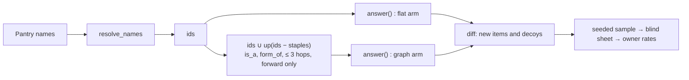

# ADR 0006 graph spike: design

Status: DESIGN, 2026-11-09. Nothing here is built. Owner decisions are marked **OWNER**.
Sources: [ADR 0006](../../decisions/0006-hybrid-graph-knowledge-base.md) (the decision rule is binding),
[ADR 0005](../../decisions/0005-honest-claims-and-eval-reset.md),
[M3 plan](../../plans/2026-11-05-m3-ingredient-foundation.md) (Task 8, D11),
[JUDGING_PROTOCOL.md](../../JUDGING_PROTOCOL.md), `pantrychef/engine.py`, `pantrychef/ingredients/table.py`.
Labels: MEASURED, ESTIMATE, HYPOTHESIS.

Terms:

- **Edge.** A value in the `is_a` or `form_of` column of `ingredients.v2.csv`. Row X with `is_a = Y` is the edge
  X `is_a` Y. `table.py` already rejects unknown targets, self-edges and cycles.
- **Arm.** One way to compute results. `flat` is the baseline. `graph` adds traversal.
- **New item.** A pair (pantry, recipe) that `graph` puts in `make_now` or `one_away` and `flat` puts in a worse
  place (a later group, or no group).
- **Decoy.** A pair (pantry, recipe) that both arms put in the same group, `make_now` or `one_away`.
- **Claim.** What the product would tell the person: "you can make this now", or "you need only this one line".

## 1. Traversal rule

### 1.1 Definition

`up(X)` is the set of ids Y that you reach from X by following edges **forward** (from the row to the value
in its `is_a` or `form_of` cell), in **1 to 3 hops**, with **both edge types, in any mix**.

A pantry item X **satisfies** a recipe line with options `{Y1, ..., Yk}` when X is some Yi (the shipped rule) or
some Yi is in `up(X)` (the traversal rule).

| Question | Rule | Reason |
| --- | --- | --- |
| Direction | Specific to general only. `cheddar` meets a "cheese" line. `unsalted_butter` meets a "butter" line | A specific item is a valid instance of the general need |
| Reverse (general meets specific) | **No.** A pantry "cheese" does not meet a "cheddar" line. A pantry "butter" does not meet an "unsalted butter" line | A general pantry name does not say which kind the person holds. This matches D6: a pantry is a claim, so we do not guess. Using the general item for the specific one is a swap. Swaps are `substitutes_for` edges in M5, with their own test |
| Depth | At most 3 hops | The table has no cycles, so traversal stops anyway. The cap limits drift to broad classes ("dairy"). Results report the hop count of each new item |
| Edge types | `is_a` and `form_of`, mixed freely on one path | Both mean "X is a kind or a form of Y". The spike tests them together and reports each type alone |
| Option sets ("A or B") | The line is met when any option is met, directly or through `up` | Same as the shipped `any(o in pantry ...)` |
| Staples | Not expanded. Staple cover stays as shipped: a line is staple-covered when an option **is** a staple id | Expanding staples changes `total` for every pantry. That would credit the graph for a staple effect, not a pantry effect |
| Optional lines | Unchanged: never needed | Shipped rule |
| Unread lines | Unchanged: no ids, always missing | Traversal cannot read a line |
| Typed names | Pantry names resolve with `resolve_names` first. Both arms get the same ids | The resolver is not under test |

### 1.2 How it plugs into `answer()`

The shipped engine does not change. The spike is offline and in Python only.

- `flat`: `answer(pack, AnswerRequest(pantry=ids, staples=pack.default_staples, limit=BIG))`.
- `graph`: the same call with `pantry = ids ∪ up(ids − staples)`.

`BIG = len(pack.recipes)`, so no group is cut. Adding ancestors to the pantry is exactly the rule in 1.1: an option
Yi is in the expanded pantry if and only if Yi is a pantry item or Yi is in `up(X)` for a pantry item X. Line
weights, staple cover and order do not change, because the pack is not touched. The expansion only adds ids, so a
recipe can only move to a better group (test `test_traversal_is_monotone`).

The pack is built in memory from the **frozen** table copy and the pinned snapshot, with `build.py` functions. The
edges are present in the table but `answer()` never reads them. So `flat` is the same table, the same collapse and
the same synonyms, with no traversal (ADR 0006 baseline).



All parts of this diagram are planned. None is built.

### 1.3 Edge signature of a new item

A **newly met line** is a needed line that `graph` meets and `flat` does not. For each newly met line, collect the
edge types on every path of 1 to 3 hops from a pantry item to an option of the line. The **signature** of a new
item is the union over its newly met lines: `{is_a}`, `{form_of}` or `{is_a, form_of}`. The signature is in the key
only. The rater never sees it.

## 2. Pantries

All 40 pantries are **dev pantries**. None may enter the M4 test split.

| Set | Count | Source | Size |
| --- | --- | --- | --- |
| `pilot01`–`pilot20` | 20 | The 20 distinct pantries of `data/eval/judging/pilot_sheet.v1.json` (24 items minus 4 repeats). Names as in the sheet | 3 to 12 names, median 7.5 (MEASURED) |
| `new01`–`new20` | 20 | Written for the spike, see below | 6 to 15 names |

### 2.1 How the 20 new pantries are written

1. **When.** After the last Task 5 table commit, and before the freeze. The edges are then final, so no edge can be
   written for these pantries.
2. **Who.** A fresh Sonnet agent with one scope. Its input is the prompt below and nothing else. It never reads the
   table, the edges, the recipes, the pack or any results file. Its output is one JSON list.
3. **Prompt (fixed, stored in the pantries file):** "Write 20 pantries. Each is what one real household has in the
   kitchen on an ordinary evening, when someone decides what to cook. Use the 20 profiles given, one each. Write
   6 to 15 items per pantry. Write each item as the person would type it in a shopping app. Do not list salt,
   pepper, oil or water." The 20 profiles are: student flat, family weekly shop, vegetarian, vegan, keen baker,
   South Asian home cook, Mexican home cook, Italian home cook, East Asian home cook, Middle Eastern home cook,
   British pub-style cook, low budget, after a party, nearly empty fridge, gym and high protein, retired couple,
   breakfast person, slow cooker user, fresh market shopper, freezer and tins.
4. The prompt does not mention kinds, forms, brands or specific names. This avoids steering the writer toward the
   edges under test. A model can still favour specific names. That is HYPOTHESIS and is reported (section 8).

### 2.2 Record

`data/eval/graph_spike/pantries.v1.json`:

```json
{"version": 1, "split": "dev", "never_in": "M4 test split",
 "writer": {"model": "...", "date": "...", "prompt": "...", "profiles": ["..."]},
 "pantries": [{"id": "pilot01", "source": "m2_pilot:item01", "source_recipe_id": "...", "names": ["..."]},
              {"id": "new01", "source": "spike_writer", "profile": "student flat", "names": ["..."]}]}
```

`source_recipe_id` for a pilot pantry comes from the seeded draw in `scripts/judging_sheet.py` (seed 42). The
engineer re-runs the draw function. The engineer does not open the private key or the pilot answers.

**M4 check (to state in the ADR update and in `docs/PROJECT_STATE.md`):** the M4 test pantry builder loads this
file and refuses a test pantry when (a) its sorted resolved id set equals the id set of any dev pantry, or (b) it
comes from a `source_recipe_id` in this file. A test in M4 asserts both.

## 3. Freeze

One commit, `chore(spike): freeze ADR 0006 spike inputs`, before any sheet exists. It adds:

- `data/eval/graph_spike/table.frozen.csv`: a byte copy of `ingredients.v2.csv` at that time.
- `data/eval/graph_spike/pantries.v1.json` (section 2).
- `data/eval/graph_spike/freeze.v1.json`:

| Field | Value |
| --- | --- |
| `table_sha256` | sha256 of the frozen table, CRLF changed to LF before hashing |
| `words_sha256`, `snapshot_sha256` | sha256 of `words.v1.json` and of the pinned snapshot |
| `code_sha256` | sha256 per file: `pantrychef/eval/graph_spike.py`, `pantrychef/engine.py`, `pantrychef/ingredients/*.py`, `pantrychef/pack/build.py` (LF-normalised) |
| `edges` | sorted list of `[from, type, to]`, and `edges_sha256` of its canonical JSON |
| `pantries_sha256` | sha256 of the pantries file |
| `plan` | `seed: 46`, `max_hops: 3`, `cap_new: 100`, `split: {"make_now": 50, "one_away": 50}`, `repeats: 10`, `bootstrap_resamples: 10000`, allocation rule name, decoy rule name |
| `thresholds` | the owner-confirmed values from section 4.5, with `confirmed_by` and `confirmed_on` |
| `pool_counts` | counts of new items per group and signature, and of decoy candidates per group. Counts only |

**Check.** `check_freeze(path) -> list[str]` recomputes every hash and returns the names of the fields that differ.
`scripts/graph_spike.py sheet` and `score` call it first and exit 1 with those names if the list is not empty. The
`score` step also checks with git that `freeze.v1.json` has exactly one commit, and that this commit is an
ancestor of the commit that adds the answers file. The live table may grow after the freeze. The spike reads
only the frozen copy.

If any frozen input changes after rating starts, the result is **exploration**. A decision then needs a new set of
pantries (ADR 0006).

## 4. Sample, sheet and scoring

### 4.1 Pool and draw

- **Pool:** all new items over the 40 pantries, in `make_now` or `one_away` (section 1). Strata are
  group × signature, at most 6.
- **Size:** at most 100 new items, 50 per group.
- **Allocation inside a group:** equal shares over the non-empty signature strata. A stratum smaller than its share
  gives all its items, and the rest goes to the other strata of the group. A group smaller than 50 gives all its
  items, and the rest goes to the other group.
- **Order:** inside a stratum, sort by `sha256(f"{seed}:new:{pantry_id}:{recipe_id}")` and take the first k.
- **Weight:** `w = stratum pool size / stratum sample size`. With a full census, every `w = 1`.
- **Decoys:** one per sampled new item, from the same pantry and the same group, taken from the decoy candidates
  in hash order with tag `decoy`. If the pantry has none left, take from all pantries in that group. A decoy is
  never also a sampled new item. Decoys get no weight. They give the baseline precision as context.
- **Repeats:** 10 sampled items (5 new, 5 decoys, hash order with tag `repeat`), shown again unmarked, at least 20
  places apart and in the other session. Only the first answer counts.
- **Shuffle:** all items by `sha256(f"{seed}:order:{item_key}")`. Items 1 to ceil(n/2) are session 1. The rest are
  session 2, on another day.

### 4.2 Sheet and key

`data/interim/graph_spike_sheet.v1.csv` (git-ignored, Wikibooks text) has one row per item:

| Column | Content |
| --- | --- |
| `item_id` | `g001` ... |
| `session` | 1 or 2 |
| `pantry` | the pantry names as written, joined by `; ` (not the table names of ids) |
| `staples` | names of `pack.default_staples` |
| `title` | the recipe title |
| `lines` | every source ingredient line, raw text, numbered `1.`, `2.` ... |
| `claim` | `make now` or `one away` |
| `missing_line` | for `one away`: the text of the one line the engine says is missing. Empty otherwise |
| `answer`, `unmet_lines`, `seconds`, `note` | empty, for the rater |

The rater does **not** see: the arm, the edges, the signature, the ids, the weight, the resolved lines or the
optional flags. The key `data/interim/graph_spike_key.v1.json` holds them. Its sha256 goes into
`data/eval/graph_spike/key_sha256.txt`, committed before rating (the pilot pattern). The script refuses to write a
different key later.

### 4.3 Rubric (fixed before rating)

> You own exactly the pantry items and the staples. Quantities do not matter. Ignore lines the recipe calls
> optional. A line is **met** when you own what it asks for, or a kind or form of it that a cook would use for
> that line without calling it a swap. A swap does not count.
>
> - Claim `make now`: is every line met?
> - Claim `one away`: is every line met, except the line shown as missing?
>
> Answer `yes`, `no` or `unsure`. If `no`, write the numbers of the lines that are not met.

Before rating, the rater writes one line in the answers file: "I have / have not read the `is_a` and `form_of`
columns of the table."

Answers go to `data/eval/graph_spike/answers.v1.csv`: `item_id, answer, unmet_lines, seconds, note`. No recipe text.

### 4.4 Scoring

An item is **correct** when the answer is `yes`. `no` and `unsure` count as wrong.

1. **Net new per pantry.** For each of the 40 pantries,
   `d_p = Σ w_i × (+1 if correct, −1 if wrong)` over its rated new items. A pantry with no new item has `d_p = 0`.
   - **Interval method.** Two 95% intervals over the 40 pantry values. (a) Percentile bootstrap over pantries:
     `paired_cluster_bootstrap(a=d, b=[0]*40, clusters=pantry_ids, resamples=10000, seed=46)`. (b) Student t
     interval, df = 39. **Decision lower bound = the smaller of the two lower bounds.**
   - **Why.** The pantry is the unit, because items in one pantry share edges and are not independent. With 40
     units, many zeros and a skewed tail, the percentile bootstrap can under-cover and the t interval can be off.
     Taking the smaller lower bound is conservative and costs nothing. The bootstrap function already exists and
     is tested.
2. **Precision per group.** For `make_now` and `one_away` alone: `Σ w × correct / Σ w` over its rated new items.
   Report also the unweighted Wilson 95% interval (`stats.wilson`) and the decoy precision of the same group.
3. **Edge types.** For each type, count the correct rated new items whose signature holds that type, and the
   number of pantries they come from.
4. **Rater consistency.** Agreement on the 10 repeats (yes vs not yes).
5. Report every figure for all 40, for `pilot` alone and for `new` alone. The decision uses all 40.

### 4.5 Thresholds (OWNER, D11): confirm or change before the freeze

ADR 0006, verbatim:

> - A query uses at least two edge types.
> - Correct new recipes minus wrong new recipes, per pantry, has a 95% interval above zero.
>   The baseline adds no new recipes, so this is a one-sample interval.
> - At least 90% of newly surfaced recipes are judged correct, for "make now" and for "one
>   away", each counted alone.

How this design makes each one exact (my proposals; the owner confirms each):

| # | ADR threshold | Exact test | Proposal |
| --- | --- | --- | --- |
| T1 | Two edge types | Each of `is_a` and `form_of` is in the signature of at least **5** correct rated new items, from at least **3** pantries | The literal reading ("at least one each") lets one lucky edge pass. Owner may choose the literal reading |
| T2 | Interval above zero | Decision lower bound (4.4.1) > 0 | Method as in 4.4 |
| T3 | 90% per group | Weighted precision ≥ 0.90 in `make_now` and in `one_away`, **and** at least **10** rated new items in each group. A group with fewer than 10 fails T3 | The ADR sets no minimum. 3 of 3 correct is not evidence. This makes a small pool a rejection, not a pass |

**Accept** only when T1, T2 and T3 all pass. Otherwise **Reject** (ADR 0006).

## 5. Rater load and small pools

- **Load (ESTIMATE):** 200 items + 10 repeats = 210 items at 30 to 45 seconds each = 1.75 to 2.6 hours, in two
  sessions on two days. A pilot pantry has a median of 7.5 names and a recipe has about 8 to 12 lines.
  `seconds` measures the real time.
- **Small pool.** If a group's pool is under 50, rate all of it (census). Decoys stay equal in number to the
  new items of each group. Results report, per group and per signature: pool size, rated count, and the note
  "census" or "sample".
- **Empty pool.** If the pool has no new item at all, no sheet is built. The result is **Rejected: traversal adds
  no new recipe beyond collapse and synonyms**. If one group has fewer than 10 new items, the spike may still run
  (the other figures are useful), but T3 fails, so the verdict is Rejected. The freeze records the pool counts, so
  the owner knows this before rating and can choose to skip the rating.

## 6. Literature and licence check

Three standard searches, 2026-11-09. Epicure is out of scope (Task 5 agent).

| Source | Finding | Label |
| --- | --- | --- |
| FoodOn ([GitHub](https://github.com/FoodOntology/foodon), [Ontobee](https://ontobee.org/ontology/FOODON), [Bioregistry](https://bioregistry.io/foodon)) | Licence CC BY 4.0. The README badge and the 2025-08-01 release metadata say so | MEASURED (pages read) |
| FoodOn paper: Dooley et al. 2018, *npj Science of Food* 2:23, [doi:10.1038/s41538-018-0032-6](https://doi.org/10.1038/s41538-018-0032-6), [PubMed](https://pubmed.ncbi.nlm.nih.gov/31304272/) | A farm-to-fork ontology. Much of its vocabulary comes from LanguaL. It imports terms from UBERON, ChEBI and NCBITaxon | MEASURED (abstract and listings) |
| FoodOn imports and LanguaL | The licences of LanguaL and of the imported terms were not checked | Open |
| FoodOn fit | Whether FoodOn holds cook-level `is_a` links such as cheddar to cheese was not checked | HYPOTHESIS: partial |
| FoodKG: Haussmann et al., ISWC 2019, [doi:10.1007/978-3-030-30796-7_10](https://doi.org/10.1007/978-3-030-30796-7_10), [site](https://foodkg.github.io) | Links recipes to FoodOn classes and USDA data. Its recipes come from Recipe1M+ | MEASURED (listing). Cannot ship (ADR 0003) |
| Shirai et al., [Frontiers in AI 2021, doi:10.3389/frai.2020.621766](https://doi.org/10.3389/frai.2020.621766) | Ranks ingredient swaps on FoodKG with semantic data and word embeddings (DIISH) | MEASURED (abstract). Relevant to M5 swaps, not to this spike |
| Teng, Lin, Adamic, WebSci 2012, [arXiv:1111.3919](https://arxiv.org/abs/1111.3919) | Complement and substitute networks mined from about 46,000 Allrecipes recipes | MEASURED (abstract). Mined swaps, not a kind-of hierarchy |

Consequences:

- The spike uses curated table edges only. It copies no FoodOn data. FoodOn is a possible later source of edge
  **proposals**, with attribution, after a check of the LanguaL and import licences.
- In these searches, no work tested with blind human judgement whether a hierarchy-expanded pantry really meets a
  recipe. HYPOTHESIS: the spike question is open, not settled by prior work. Three searches are not a review.

## 7. Engineer task list

Build in this order. Each step ends with `uv run pytest -q`, `uv run ruff check .`, `uv run ruff format --check .`.

**Step A (own commit, before any spike code): register the metrics and arms** in `pantrychef/eval/results.py`.
A metric and a model must not change in the same step.

- `graph_net_new_per_pantry`: role `selection`, depends on `()`, reason "blind hand judgement; the label does not
  read the edges".
- `graph_new_precision_make_now`, `graph_new_precision_one_away`: role `selection`, same reason.
- `graph_decoy_precision`, `graph_rater_repeat_agreement`: role `sanity`.
- Arms: `table_flat` = `("idf", "have", "total", "group")`; `graph_traversal` = the same plus `("is_a", "form_of")`.

**Step B: `pantrychef/eval/graph_spike.py`.**

```python
EDGE_TYPES = ("is_a", "form_of")
MAX_HOPS = 3
GROUP_RANK = {"make_now": 0, "one_away": 1, "two_away": 2}  # absent = 3

def edge_list(table: IngredientTable) -> list[tuple[str, str, str]]: ...       # sorted (from, type, to)
def up(table: IngredientTable, item: str, max_hops: int = MAX_HOPS) -> dict[str, frozenset[str]]:
    """Ancestor id -> edge types seen on any forward path of 1..max_hops hops."""
def expand(table, pantry: set[str], staples: set[str]) -> set[str]:            # pantry ∪ up(pantry − staples)
def placements(pack: Pack, ids: list[str]) -> dict[str, str]:                  # recipe_id -> group, limit=len(recipes)
def diff(pack, table, pantry_id: str, ids: list[str]) -> tuple[list[NewItem], dict[str, list[str]]]:
    """New items (recipe_id, group, flat_group, signature, hops) and decoy candidates per group."""
def draw(pool: list[NewItem], decoys: dict, seed: int, cap: int = 100) -> list[SheetItem]: ...
def sheet_rows(items: list[SheetItem], pack, pantries) -> list[dict]: ...      # only the 4.2 columns
def score(key: dict, answers: list[dict], thresholds: dict, seed: int) -> dict: ...
def freeze_manifest(root: Path, plan: dict, thresholds: dict) -> dict: ...
def check_freeze(path: Path) -> list[str]: ...                                 # names of changed fields
```

`NewItem` and `SheetItem` are frozen dataclasses. No edge logic goes into `engine.py`.

**Step C: `scripts/graph_spike.py`**, a thin entry point with three subcommands:
`pantries` (load the 40, resolve, print unknown names), `freeze` (write the copy and the manifest, print pool
counts), `sheet` (check, draw, write sheet and key, write `key_sha256.txt`), `score` (check, read answers, write the
results file).

**Step D: tests, `tests/eval/test_graph_spike.py`** (invented fixture table and recipes only):

| Test | Assertion |
| --- | --- |
| `test_up_follows_edges_forward` | `cheese in up(cheddar)`; `cheddar not in up(cheese)` |
| `test_reverse_direction_never_satisfies` | pantry `{cheese}`, line `cheddar`: same group in both arms |
| `test_depth_limit` | chain a→b→c→d→e: `d in up(a)`, `e not in up(a)` |
| `test_mixed_edge_types_on_one_path` | `x form_of y`, `y is_a z`: `up(x)[z] == {"is_a", "form_of"}` |
| `test_option_set_any_option` | line options `(butter, margarine)`, pantry `{unsalted_butter}`: met in `graph`, not in `flat` |
| `test_staples_not_expanded` | staple `s is_a t`, line `t`, `s` only a staple: not met in either arm. With `s` typed in the pantry too, still not met |
| `test_optional_and_unread_unchanged` | optional line never counts; unread line stays missing in `graph` |
| `test_flat_equals_answer` | `placements` without expansion equals `answer()` groups on the fixture pack |
| `test_traversal_is_monotone` | for every fixture pantry and recipe, `GROUP_RANK[graph] <= GROUP_RANK[flat]` |
| `test_signature_uses_newly_met_lines_only` | a line met directly does not add a type |
| `test_draw_is_seeded_and_stratified` | same seed gives the same items; seed 47 differs; at most 50 per group unless borrowed; equal shares over strata |
| `test_decoys_match_new_per_group` | decoy count per group = new count per group; every decoy is the same group in both arms |
| `test_sheet_hides_arm_and_edges` | sheet rows have only the 4.2 columns; no cell holds an id, `is_a`, `form_of`, `flat`, `graph` or a weight |
| `test_score_hand_case` | 3 pantries with hand weights give the hand `d_p`, precision and edge-type counts |
| `test_unsure_counts_as_wrong` | one `unsure` lowers precision as `no` does |
| `test_empty_pool_rejects` | empty pool: verdict `rejected`, reason `no_new_recipes`, no sheet |
| `test_small_group_fails_t3` | 9 of 9 correct in one group: T3 fails |
| `test_freeze_check_names_changed_field` | change one byte of the frozen table: returns `["table_sha256"]` |
| `test_hash_ignores_crlf` | CRLF and LF copies hash the same |
| `test_spike_pantries_are_dev_only` | the real pantries file: 40 pantries, 20 `pilot`, 20 `new`, `split == "dev"`, unique ids |

**Step E: outputs.** `results/m3_graph_spike.json` through `results.py`, with the standard fields (commit, dirty
flag, command, corpus fingerprint, seed) and:

`freeze_commit`, `freeze_sha256`, `thresholds`, `pantries` (`n`, `pilot`, `new`, `unknown_names`),
`pool` (per group × signature), `rated` (new, decoys, repeats, census or sample per stratum), `hops` (count per hop
number), `net_new_per_pantry` (`mean`, `boot_lo`, `boot_hi`, `t_lo`, `t_hi`, `decision_lo`), per group
`precision` (`weighted`, `n`, `wilson_lo`, `wilson_hi`, `decoy_precision`, `decoy_n`), `edge_types` (per type:
correct items, pantries), `split_report` (the same figures for `pilot` and for `new`), `repeat_agreement`,
`rater` (`count: 1`, `read_edges: yes|no`), `checks` (`T1`, `T2`, `T3`: pass or fail), `verdict`
(`accepted`, `rejected` or `exploration`), `limits` (list of text).

**Step F: the ADR update.**

- **Accepted:** Status Accepted, with the date. A link to the results file and the freeze commit. The figures for
  T1 to T3, with intervals and the split report. The edge count per type. The limits from section 8 that apply
  (one rater, rater read edges or not, model-written pantries). The word "graph" may then be used (ADR 0006,
  "What counts as a graph"). Next steps: precompute `up` at build time (ADR 0004 option 2) and add parity cases.
  The shipped engine changes only in a later milestone, with its own tests.
- **Rejected:** Status Rejected, with the date. Which threshold failed and by how much, or "no new recipes". A link
  to the results file. The table keeps its `is_a` and `form_of` columns as data. The documents keep the word
  "table". State whether a new spike would need new pantries (it does if edges change).
- **Both:** the M4 rule of section 2.2 (the 40 dev pantries never enter the M4 test split). The literature and
  licence table of section 6. If edges changed after rating: label the result exploration, and do not decide.

## 8. Risks and how a result could mislead

| Risk | Effect | Control |
| --- | --- | --- |
| Edges define the labels | Precision looks high because the label reads the edges | The rater sees raw lines and pantry names, never ids or edges. The rubric says what "met" means without the table |
| Edges written after seeing pantries | Edges fit the test pantries | New pantries are written after the last edge commit, blind to the table. Task 5 agents may have seen the pilot pantries, so the split report shows `pilot` and `new` apart. If only `pilot` passes, say so |
| Rater also read or wrote edges | The rater expects an edge and says yes | The owner did not write edges (Task 5 is Sonnet), but may have reviewed them. The rater states this in the answers file. The results file reports it |
| One rater | One person's view of "a kind of" | Report as a limit. 10 repeats measure self-agreement. A second rater would help in M4 (HYPOTHESIS) |
| Decoys look different | New items lean on general lines ("cheese"), so the rater may guess the arm | Cannot be fully hidden. Report it. Decoy precision shows the rater's baseline rate |
| Error not caused by an edge | A parser error on another line makes a new item wrong | It counts as wrong, which is conservative. `unmet_lines` allows a later attribution, labelled exploration |
| Model-written pantries | The writer may favour specific names, which favours traversal | The prompt does not mention kinds or forms. HYPOTHESIS until real pantries exist |
| Weighted estimates | A small stratum gets a large weight, so the precision moves a lot | Report weighted and unweighted figures, and the pool and sample sizes |
| Volume in `d_p` | Many new items lift `d_p` even when some are wrong | T3 guards precision separately |
| Edge changes after rating | The decision is no longer one pass | `check_freeze` fails. The result is exploration. A decision needs new pantries |
| Python only | An Accepted spike does not mean the browser does it | The ADR update states that shipping needs a precomputed expansion and parity tests |
