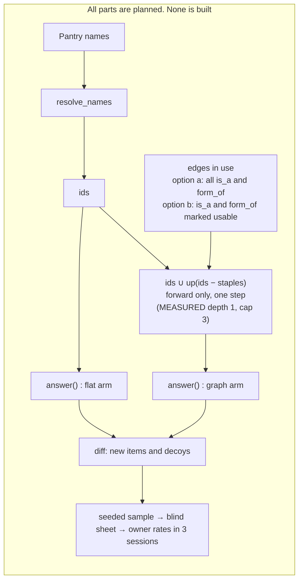
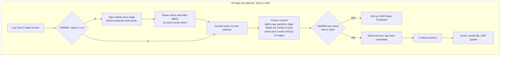

# ADR 0006 graph spike: design

Status: DESIGN, 2026-11-09, revised after an independent review on the same day. Nothing here is built. Owner
decisions are marked **OWNER**. Section 10 lists them.
Sources: [ADR 0006](../../decisions/0006-hybrid-graph-knowledge-base.md) (the decision rule is binding),
[ADR 0005](../../decisions/0005-honest-claims-and-eval-reset.md),
[M3 plan](../../plans/2026-11-05-m3-ingredient-foundation.md) (Task 8, D11),
[JUDGING_PROTOCOL.md](../../JUDGING_PROTOCOL.md), `pantrychef/engine.py`, `pantrychef/ingredients/table.py`.
Labels: MEASURED, ESTIMATE, HYPOTHESIS.

## Changes after review

The review (Opus, verdict GO WITH FIXES) gave 5 required fixes (R), 6 recommended improvements (I) and 4
observations (O). This revision applies all R and I items, and O1 and O4.

| Item | Change | Where |
| --- | --- | --- |
| R1 | `form_of` mostly means "made from". The measured semantics are stated. The owner chooses edge option (a) or (b). The procedure for (b) is written | 1.1 (row "Edge meaning"), 1.4, 3, 7, 8, 10 |
| R2 | Precision and Wilson interval per signature stratum. Wrong counts per edge. Any decision on a subset found after rating is exploration | 4.4 (item 3), 7 Step E |
| R3 | MEASURED max depth is 1, so `up` is a one-step lookup. The freeze re-checks the depth. The Accepted text says "one-step" | 1.1 (row "Depth"), 1.2 diagram, 3, 7 Step F |
| R4 | The rubric no longer uses the words "kind or form" | 4.3 |
| R5 | Examples are now real edges (`paneer` `is_a` `cheese`, `garlic_paste` `form_of` `garlic`). ESTIMATE: the cheese pool is small | 1.1 (rows "Direction", "Reverse"), 7 Step D |
| I1 | Load is now 45 to 90 s per item, 2.6 to 5.3 h, in 3 sessions. The plan's "about 2 hours" is out of date | 5, 0.1 |
| I2 | T3 minimum is 20. The Wilson lower bound is printed. A Wilson-lower-bound variant is offered to the owner | 4.5 |
| I3 | Guard: if the `new` pantries fail while all 40 pass, the verdict is exploration | 4.4 (item 5), 4.5 |
| I4 | Repeats go into another session at a hash-chosen place, at least 20 places away | 4.1 |
| I5 | Zero pantries stay in as zeros. Weights act as Horvitz-Thompson scaling. Report the number of pantries with `d_p > 0` | 4.4 (item 1) |
| I6 | Risk of shared Sonnet word choice. Report names that hit an edge source, for `pilot` and `new` | 4.4 (item 6), 8 |
| O1 | The freeze prints pool counts per edge (top 10). The owner can skip the rating after this pre-check | 3, 5 |
| O2 | No change. The ADR requires an equal number of decoys. Fewer decoys need an ADR edit | 4.1 (note) |
| O3 | No change. The review found these parts adequate | none |
| O4 | The owner confirms "unsure = wrong" together with the thresholds | 4.4, 4.5, 10 |

### 0.1 Plan text that this design replaces

| Plan text | This design | Reason |
| --- | --- | --- |
| Task 8: "X `is_a`* Y or X `form_of` Y" (transitive `is_a`) | One-step lookup over the edges in use (option a or b) | MEASURED: max depth 1. Most `form_of` edges are not usable forward (R1) |
| D11: "about 2 hours" | 2.6 to 5.3 hours, up to 3 sessions (ESTIMATE) | No timing evidence for 30 to 45 s per item (I1) |
| D11: thresholds as in the ADR | T1 to T3 made exact, T3 minimum 20, "unsure = wrong" | Section 4.5 |

This file does not edit the plan. The plan owner updates D11 and Task 8 after the owner answers section 10.

Terms:

- **Edge.** A value in the `is_a` or `form_of` column of `ingredients.v2.csv`. Row X with `is_a = Y` is the edge
  X `is_a` Y. A cell can hold more than one target, split by `|` (MEASURED: one cell,
  `ginger_garlic_paste` `form_of` `ginger|garlic`). `table.py` already rejects unknown targets, self-edges and
  cycles.
- **Edges in use.** The edges that traversal follows. Option (a): all edges. Option (b): the edges that the
  classifier of section 1.4 marks forward-usable, after the owner's edits.
- **Arm.** One way to compute results. `flat` is the baseline. `graph` adds traversal.
- **New item.** A pair (pantry, recipe) that `graph` puts in `make_now` or `one_away` and `flat` puts in a worse
  place (a later group, or no group).
- **Decoy.** A pair (pantry, recipe) that both arms put in the same group, `make_now` or `one_away`.
- **Claim.** What the product would tell the person: "you can make this now", or "you need only this one line".

## 1. Traversal rule

### 1.0 Edge facts (MEASURED, 2026-11-09, working copy of `ingredients.v2.csv`, 872 rows)

- 81 `is_a` edges. 76 `form_of` edges in 75 rows. No row has both types.
- Max depth is 1. No edge target is the source of another edge. So no path has 2 or more hops.
- `cheddar`, `mozzarella` and `parmesan` have no edge. 17 ids have `is_a cheese` (for example `paneer`, `brie`,
  `gouda`, `halloumi`).
- `unsalted_butter` is not an id. "unsalted butter" is a synonym of `butter`, so `flat` already meets it.
- The id `beef` holds the synonyms steak, sirloin, ribeye, stewing beef and others. The id `potato` holds russet
  potato and other named potatoes. A line "ribeye steak" therefore resolves to `beef`.
- The 4 staples (`water`, `salt`, `black_pepper`, `vegetable_oil`) have no edges.

Task 5 can still change the table. The freeze re-measures these facts (section 3).

### 1.1 Definition

`up(X)` is the set of ids Y that you reach from X by following **edges in use forward** (from the row to the
value in its `is_a` or `form_of` cell), in **1 to `max_hops` hops**. `max_hops` is 3. With the measured table,
every path has 1 hop, so `up(X)` is the set of direct targets of X.

A pantry item X **satisfies** a recipe line with options `{Y1, ..., Yk}` when X is some Yi (the shipped rule) or
some Yi is in `up(X)` (the traversal rule).

| Question | Rule | Reason |
| --- | --- | --- |
| Direction | Specific to general only. `paneer` meets a "cheese" line (`paneer` `is_a` `cheese`). `garlic_paste` meets a "garlic" line (`garlic_paste` `form_of` `garlic`), if that edge is in use | A specific item can be a valid instance of the general need. Whether it is valid for a given edge is the question of the row "Edge meaning" |
| Reverse (general meets specific) | **No.** A pantry "cheese" does not meet a "paneer" line. A pantry "garlic" does not meet a "garlic paste" line | A general pantry name does not say which kind the person holds. This matches D6: a pantry is a claim, so we do not guess. Using the general item for the specific one is a swap. Swaps are `substitutes_for` edges in M5, with their own test |
| Edge meaning (R1) | MEASURED: in most `form_of` rows, X is **made from** Y, not an instance of Y. Forward use is wrong for these. Examples: `potato_chip`, `french_fries`, `potato_starch` would meet a "russet potato" line (it resolves to `potato`). `ground_beef`, `corned_beef`, `beef_heart` would meet a "ribeye steak" line. `almond_milk` would meet "almond", `orange_oil` "orange", `tomato_juice` "tomato", `pork_blood` "pork", `coconut_water` "coconut", `pumpkin_seed` "pumpkin", `sauerkraut` "cabbage". Some `is_a` edges have the same problem: `frozen_yogurt` to `yogurt`, `ravioli` and `tortellini` to `pasta`, `croissant` and `bagel` to `bread`, `horseradish_sauce` to `horseradish`, `port`, `vermouth` and `sparkling_wine` to `wine` | HYPOTHESIS: about 10 of 76 `form_of` edges are usable forward (for example `garlic_paste`, `ginger_paste`, `ground_chicken`). Under option (a), these errors go into the pool. The blind rating catches them, but a rejection would then mean "wrong edge semantics", not "traversal does not help". **OWNER** chooses option (a) or (b) before the freeze (section 1.4) |
| Depth | At most `max_hops = 3`. MEASURED at design time: max depth 1, so `up` is a one-step lookup. The freeze re-measures it as `max_depth_observed` | The table has no cycles, so traversal stops anyway. Results report the hop count of each new item. With depth 1, the spike can show that one-step edge lookups help. It cannot show that multi-hop traversal helps |
| Edge types | `is_a` and `form_of` edges in use. At depth 1 a path has one type | The spike tests the edges in use together and reports each type alone |
| Option sets ("A or B") | The line is met when any option is met, directly or through `up` | Same as the shipped `any(o in pantry ...)` |
| Staples | Not expanded. Staple cover stays as shipped: a line is staple-covered when an option **is** a staple id | Expanding staples changes `total` for every pantry. That would credit the graph for a staple effect, not a pantry effect. MEASURED: the 4 staples have no edges, so this rule changes nothing today |
| Optional lines | Unchanged: never needed | Shipped rule |
| Unread lines | Unchanged: no ids, always missing | Traversal cannot read a line |
| Typed names | Pantry names resolve with `resolve_names` first. Both arms get the same ids | The resolver is not under test |

ESTIMATE (R5): the cheese part of the pool is small. The common pantry cheeses (`cheddar`, `mozzarella`,
`parmesan`) have no `is_a cheese` edge, so they add no new item.

### 1.2 How it plugs into `answer()`

The shipped engine does not change. The spike is offline and in Python only.

- `flat`: `answer(pack, AnswerRequest(pantry=ids, staples=pack.default_staples, limit=BIG))`.
- `graph`: the same call with `pantry = ids ∪ up(ids − staples)`.

`BIG = len(pack.recipes)`, so no group is cut. Adding ancestors to the pantry is exactly the rule in 1.1: an option
Yi is in the expanded pantry if and only if Yi is a pantry item or Yi is in `up(X)` for a pantry item X. Line
weights, staple cover and order do not change, because the pack is not touched. The expansion only adds ids, so a
recipe can only move to a better group (test `test_traversal_is_monotone`).

The pack is built in memory from the **frozen** table copy and the pinned snapshot, with `build.py` functions. The
edges are present in the table but `answer()` never reads them. So `flat` is the same table, the same collapse and
the same synonyms, with no traversal (ADR 0006 baseline).



### 1.3 Edge signature of a new item

A **newly met line** is a needed line that `graph` meets and `flat` does not. For each newly met line, collect the
edge types on every path in use from a pantry item to an option of the line. The **signature** of a new item is
the union over its newly met lines: `{is_a}`, `{form_of}` or `{is_a, form_of}`. A new item can have
`{is_a, form_of}` only when two lines (or two pantry items) use different types, because no single path mixes
types at depth 1. The key also records the **edges** of each new item: every `(from, type, to)` on those paths.
The signature and the edges are in the key only. The rater never sees them.

### 1.4 Edge option (OWNER, D11 addendum, R1)

The owner chooses one option before the freeze. Neither is the default.

- **Option (a): all edges, as Task 8 says.** Traversal follows all `is_a` and `form_of` edges. This tests the table
  as written. HYPOTHESIS: many new items come from "made from" edges and are wrong, so T3 likely fails. A rejection
  would then say more about edge meaning than about traversal.
- **Option (b): `is_a` and `form_of` edges marked forward-usable.** A classifier chooses the edges before any pool
  exists. Procedure:
  1. **When.** After the last Task 5 table commit. Before the 20 new pantries are written, and before any pool
     count is computed.
  2. **Who.** A fresh Opus agent with one scope. It does not read the pantries, the pilot sheet, the recipes, the
     pack or any results file.
  3. **Input.** Every `is_a` and `form_of` edge as `(from, type, to)`, with the table name and the synonyms of both
     ends. The rubric of section 4.3, unchanged.
  4. **Task.** For each edge, answer: "If a person owns `from`, does `from` meet a recipe line that asks for `to`,
     under this rubric?" Answer `usable` or `not usable`, with one short reason. If unsure, answer `not usable`.
  5. **Output.** `data/eval/graph_spike/edge_labels.v1.json`: one record per edge, with `from`, `type`, `to`,
     `label`, `reason`, and the classifier model and date.
  6. **Owner skim.** The owner may skim the list and change any label before the freeze. Each change is recorded
     in `owner_edits` (edge, old label, new label). The owner must not see any pool count before this step ends.
  7. **Freeze.** The list goes into the freeze commit. `freeze.v1.json` records its sha256 and the final
     `edges_in_use` (section 3). No label changes after the freeze. A change after the freeze makes the result
     exploration (section 3).

Under both options, T1 still needs both edge types in correct new items. Under (b), if the classifier keeps few
`form_of` edges, T1 can fail. That is a valid result.

Under (b), one model chose the edges with the same rubric that the rater uses. The rater still sees no edges, so
the label does not read the edges. The results file reports the option, the number of edges in use per type, and
the number of owner edits.

## 2. Pantries

All 40 pantries are **dev pantries**. None may enter the M4 test split.

| Set | Count | Source | Size |
| --- | --- | --- | --- |
| `pilot01`–`pilot20` | 20 | The 20 distinct pantries of `data/eval/judging/pilot_sheet.v1.json` (24 items minus 4 repeats). Names as in the sheet | 3 to 12 names, median 7.5 (MEASURED) |
| `new01`–`new20` | 20 | Written for the spike, see below | 6 to 15 names |

### 2.1 How the 20 new pantries are written

1. **When.** After the last Task 5 table commit, after the edge labels of option (b) if chosen, and before the
   freeze. The edges are then final, so no edge can be written for these pantries.
2. **Who.** A fresh Sonnet agent with one scope. Its input is the prompt below and nothing else. It never reads the
   table, the edges, the edge labels, the recipes, the pack or any results file. Its output is one JSON list.
3. **Prompt (fixed, stored in the pantries file):** "Write 20 pantries. Each is what one real household has in the
   kitchen on an ordinary evening, when someone decides what to cook. Use the 20 profiles given, one each. Write
   6 to 15 items per pantry. Write each item as the person would type it in a shopping app. Do not list salt,
   pepper, oil or water." The 20 profiles are: student flat, family weekly shop, vegetarian, vegan, keen baker,
   South Asian home cook, Mexican home cook, Italian home cook, East Asian home cook, Middle Eastern home cook,
   British pub-style cook, low budget, after a party, nearly empty fridge, gym and high protein, retired couple,
   breakfast person, slow cooker user, fresh market shopper, freezer and tins.
4. The prompt does not mention kinds, forms, brands or specific names. This avoids steering the writer toward the
   edges under test. A model can still favour specific names. Sonnet also wrote the edges in Task 5, so the two
   may share word choices. Both are HYPOTHESIS and are reported (sections 4.4 and 8).

### 2.2 Record

`data/eval/graph_spike/pantries.v1.json`:

```json
{"version": 1, "split": "dev", "never_in": "M4 test split",
 "writer": {"model": "...", "date": "...", "prompt": "...", "profiles": ["..."]},
 "pantries": [{"id": "pilot01", "source": "m2_pilot:item01", "source_recipe_id": "...", "names": ["..."]},
              {"id": "new01", "source": "spike_writer", "profile": "student flat", "names": ["..."]}]}
```

`source_recipe_id` for a pilot pantry comes from the seeded draw in `scripts/judging_sheet.py` (seed 42). The
engineer re-runs the draw function. The engineer does not open the private key or the pilot answers.

**M4 check (to state in the ADR update and in `docs/PROJECT_STATE.md`):** the M4 test pantry builder loads this
file and refuses a test pantry when (a) its sorted resolved id set equals the id set of any dev pantry, or (b) it
comes from a `source_recipe_id` in this file. A test in M4 asserts both.

## 3. Freeze



One commit, `chore(spike): freeze ADR 0006 spike inputs`, before any sheet exists. It adds:

- `data/eval/graph_spike/table.frozen.csv`: a byte copy of `ingredients.v2.csv` at that time.
- `data/eval/graph_spike/pantries.v1.json` (section 2).
- `data/eval/graph_spike/edge_labels.v1.json` (option b only, section 1.4).
- `data/eval/graph_spike/freeze.v1.json`:

| Field | Value |
| --- | --- |
| `table_sha256` | sha256 of the frozen table, CRLF changed to LF before hashing |
| `words_sha256`, `snapshot_sha256` | sha256 of `words.v1.json` and of the pinned snapshot |
| `code_sha256` | sha256 per file: `pantrychef/eval/graph_spike.py`, `pantrychef/engine.py`, `pantrychef/ingredients/*.py`, `pantrychef/pack/build.py` (LF-normalised) |
| `edges` | sorted list of all `[from, type, to]` in the table, and `edges_sha256` of its canonical JSON |
| `edge_option` | `"a"` or `"b"`, with `confirmed_by` and `confirmed_on` |
| `edge_labels_sha256`, `owner_edits` | option (b) only: sha256 of the labels file, and the list of owner changes |
| `edges_in_use` | sorted list of `[from, type, to]` that traversal follows, its sha256, and the count per type |
| `max_depth_observed` | the longest forward path over the edges in use (MEASURED at design time: 1) |
| `pantries_sha256` | sha256 of the pantries file |
| `plan` | `seed: 46`, `max_hops: 3`, `cap_new: 100`, `split: {"make_now": 50, "one_away": 50}`, `repeats: 10`, `repeat_min_gap: 20`, `sessions: 3`, `bootstrap_resamples: 10000`, allocation rule name, decoy rule name, repeat placement rule name |
| `thresholds` | the owner-confirmed values from section 4.5: T1, T2, T3 form (`point` or `wilson_lb`), T3 minimum, `unsure_is_wrong: true`, `new_subset_guard: true`, with `confirmed_by` and `confirmed_on` |
| `pool_counts` | counts of new items per group and signature, and of decoy candidates per group. Counts only |
| `pool_by_edge` | the 10 edges in use with the most new items in the pool: `[from, type, to, count]`. Counts only (O1) |
| `edge_source_hits` | number of pantry names that resolve to the source of an edge in use, for `pilot` and for `new` (I6) |

**Check.** `check_freeze(path) -> list[str]` recomputes every hash and returns the names of the fields that differ.
`scripts/graph_spike.py sheet` and `score` call it first and exit 1 with those names if the list is not empty. The
`score` step also checks with git that `freeze.v1.json` has exactly one commit, and that this commit is an
ancestor of the commit that adds the answers file. The live table may grow after the freeze. The spike reads
only the frozen copy.

If any frozen input changes after rating starts, the result is **exploration**. A decision then needs a new set of
pantries (ADR 0006). This includes the edge option and the edge labels.

**Pre-check (O1).** The `freeze` command prints `pool_counts` and `pool_by_edge`. The owner reads them before any
sheet exists, and may skip the rating (section 5). The owner must not change the edges, the edge option or the
labels after reading the counts. That would be tuning on the pool. A new attempt then needs new pantries.

## 4. Sample, sheet and scoring

### 4.1 Pool and draw

- **Pool:** all new items over the 40 pantries, in `make_now` or `one_away` (section 1). Strata are
  group × signature, at most 6.
- **Size:** at most 100 new items, 50 per group.
- **Allocation inside a group:** equal shares over the non-empty signature strata. A stratum smaller than its share
  gives all its items, and the rest goes to the other strata of the group. A group smaller than 50 gives all its
  items, and the rest goes to the other group.
- **Order:** inside a stratum, sort by `sha256(f"{seed}:new:{pantry_id}:{recipe_id}")` and take the first k.
- **Weight:** `w = stratum pool size / stratum sample size`. With a full census, every `w = 1`.
- **Decoys:** one per sampled new item, from the same pantry and the same group, taken from the decoy candidates
  in hash order with tag `decoy`. If the pantry has none left, take from all pantries in that group. A decoy is
  never also a sampled new item. Decoys get no weight. They give the baseline precision as context. The ADR
  requires an equal number of decoys. Fewer decoys need an ADR edit (O2).
- **Shuffle and sessions:** shuffle the base items (new items and decoys) by `sha256(f"{seed}:order:{item_key}")`.
  Split the shuffled list into 3 sessions of near-equal size, in order.
- **Repeats (I4):** choose 10 base items (5 new, 5 decoys, hash order with tag `repeat`). Insert each repeat,
  unmarked, into the next session (session 3 goes to session 1), at the place given by
  `sha256(f"{seed}:repeat:{item_key}")` modulo (session length + 1). If that place is fewer than 20 places from the
  original in the overall order, move it forward one place at a time until the gap is 20 or more. Only the first
  answer counts.
- **Sessions:** on different days where possible. The owner may rate in fewer sittings, but keeps the session
  order.

### 4.2 Sheet and key

`data/interim/graph_spike_sheet.v1.csv` (git-ignored, Wikibooks text) has one row per item:

| Column | Content |
| --- | --- |
| `item_id` | `g001` ... |
| `session` | 1, 2 or 3 |
| `pantry` | the pantry names as written, joined by `; ` (not the table names of ids) |
| `staples` | names of `pack.default_staples` |
| `title` | the recipe title |
| `lines` | every source ingredient line, raw text, numbered `1.`, `2.` ... |
| `claim` | `make now` or `one away` |
| `missing_line` | for `one away`: the text of the one line the engine says is missing. Empty otherwise |
| `answer`, `unmet_lines`, `seconds`, `note` | empty, for the rater |

The rater does **not** see: the arm, the edges, the signature, the ids, the weight, the resolved lines or the
optional flags. The key `data/interim/graph_spike_key.v1.json` holds them, and the edges of each new item
(section 1.3). Its sha256 goes into `data/eval/graph_spike/key_sha256.txt`, committed before rating (the pilot
pattern). The script refuses to write a different key later.

### 4.3 Rubric (fixed before rating)

> You own exactly the pantry items and the staples. Quantities do not matter. Ignore lines the recipe calls
> optional. A line is **met** when you own what it asks for, or a more specific kind that a cook would put in
> without changing the recipe. If a cook would call it a substitute, the line is not met.
>
> - Claim `make now`: is every line met?
> - Claim `one away`: is every line met, except the line shown as missing?
>
> Answer `yes`, `no` or `unsure`. If `no`, write the numbers of the lines that are not met.

The rubric does not use the names of the edge types under test (R4). Option (b) uses the same rubric for the
classifier.

Before rating, the rater writes one line in the answers file: "I have / have not read the `is_a` and `form_of`
columns of the table, or the edge labels."

Answers go to `data/eval/graph_spike/answers.v1.csv`: `item_id, answer, unmet_lines, seconds, note`. No recipe text.

### 4.4 Scoring

An item is **correct** when the answer is `yes`. `no` and `unsure` count as wrong (**OWNER** confirms, O4).

1. **Net new per pantry.** For each of the 40 pantries,
   `d_p = Σ w_i × (+1 if correct, −1 if wrong)` over its rated new items. A pantry with no new item stays in the
   set with `d_p = 0`. The weights `w` act as Horvitz-Thompson scaling inside `d_p`: each rated item stands for
   `w` pool items of its stratum.
   - **Interval method.** Two 95% intervals over the 40 pantry values. (a) Percentile bootstrap over pantries:
     `paired_cluster_bootstrap(a=d, b=[0]*40, clusters=pantry_ids, resamples=10000, seed=46)`. With one value per
     pantry, this is a plain bootstrap over 40 values. (b) Student t interval, df = 39. **Decision lower bound =
     the smaller of the two lower bounds.**
   - **Why.** The pantry is the unit, because items in one pantry share edges and are not independent. With 40
     units, many zeros and a skewed tail, the percentile bootstrap can under-cover and the t interval can be off.
     Taking the smaller lower bound is conservative and costs nothing. The bootstrap function already exists and
     is tested.
   - **Also report** the number of pantries with `d_p > 0` and with `d_p < 0`. When new items are spread over
     many pantries, T3 at 0.90 nearly implies T2. The real role of T2 is to stop an accept that rests on 1 or 2
     pantries.
2. **Precision per group.** For `make_now` and `one_away` alone: `Σ w × correct / Σ w` over its rated new items.
   Report also the unweighted Wilson 95% interval (`stats.wilson`) and the decoy precision of the same group.
3. **Edge types and edges (R2).**
   - Per signature stratum (group × signature): weighted precision, the unweighted Wilson 95% interval, the rated
     count and the pool count.
   - Per edge type: the number of correct and of wrong rated new items whose signature holds that type, and the
     number of pantries they come from.
   - Per edge `(from, type, to)`: the number of correct and of wrong rated new items that use it.
   - **Any accept or reject for a subset of edge types or edges found after rating is exploration. A decision on
     it needs new pantries.** These figures describe the result. They do not select edges.
4. **Rater consistency.** Agreement on the 10 repeats (yes vs not yes).
5. **Split report.** Report every figure for all 40, for `pilot` alone and for `new` alone. The decision uses all
   40, with the guard of section 4.5.
6. **Edge source hits (I6).** The number of pantry names that resolve to the source of an edge in use, for
   `pilot` and for `new`, as a count and per pantry.

### 4.5 Thresholds (OWNER, D11): confirm or change before the freeze

ADR 0006, verbatim:

> - A query uses at least two edge types.
> - Correct new recipes minus wrong new recipes, per pantry, has a 95% interval above zero.
>   The baseline adds no new recipes, so this is a one-sample interval.
> - At least 90% of newly surfaced recipes are judged correct, for "make now" and for "one
>   away", each counted alone.

How this design makes each one exact (my proposals; the owner confirms each):

| # | ADR threshold | Exact test | Proposal |
| --- | --- | --- | --- |
| T1 | Two edge types | Each of `is_a` and `form_of` is in the signature of at least **5** correct rated new items, from at least **3** pantries | The literal reading ("at least one each") lets one lucky edge pass. Owner may choose the literal reading |
| T2 | Interval above zero | Decision lower bound (4.4.1) > 0 | Method as in 4.4 |
| T3 | 90% per group | **Form `point` (literal ADR):** weighted precision ≥ 0.90 in `make_now` and in `one_away`. The Wilson 95% lower bound is printed next to it. **Form `wilson_lb` (variant):** unweighted Wilson 95% lower bound ≥ 0.80 in each group. Both forms: at least **20** rated new items in each group. A group with fewer than 20 fails T3 | The ADR sets no minimum. At 10 of 10 correct, the Wilson lower bound is about 0.72. At 45 of 50 (0.90), it is about 0.79. So the point form passes with weak evidence. The `wilson_lb` form at n = 50 needs 46 of 50. At n = 20 it needs 20 of 20 (lower bound about 0.84; 19 of 20 gives about 0.76). Owner chooses one form |

Values computed by hand from the Wilson formula, z = 1.96.

**Guard (I3).** The Task 5 edge writers may have seen the pilot pantries. If all three tests pass on the 40
pantries, but the `new` pantries alone have mean `d_p ≤ 0`, or weighted precision < 0.85 in either group, the
verdict is **exploration**, not accepted.

**Unsure (O4).** `unsure` counts as wrong. This is conservative and matches the ADR. The owner confirms it with T1
to T3.

**Accept** only when T1, T2 and T3 all pass and the guard does not apply. Otherwise **Reject** (ADR 0006), or
**exploration** under the guard or a changed freeze.

## 5. Rater load and small pools

- **Load (ESTIMATE, I1):** 200 items + 10 repeats = 210 items at 45 to 90 seconds each = 2.6 to 5.3 hours, in 3
  sessions. No timing evidence exists: the M2 pilot results have `median_seconds: null`. A `make now` item asks
  the rater to check 8 to 12 lines against 3 to 15 names (pilot median 7.5, MEASURED) plus staples. `seconds`
  measures the real time. The plan's D11 figure of "about 2 hours" is out of date (section 0.1).
- **Small pool.** If a group's pool is under 50, rate all of it (census). Decoys stay equal in number to the
  new items of each group. Results report, per group and per signature: pool size, rated count, and the note
  "census" or "sample". A smaller pool also shortens the load.
- **Empty pool.** If the pool has no new item at all, no sheet is built. The result is **Rejected: traversal adds
  no new recipe beyond collapse and synonyms**. If one group has fewer than 20 new items, the spike may still run
  (the other figures are useful), but T3 fails, so the verdict is Rejected.
- **Skip after the pre-check (O1).** The freeze records `pool_counts` and `pool_by_edge`, so the owner knows the
  pool before rating. If a group has fewer than 20 new items, or a few derived-product edges (for example
  `potato_chip` to `potato`) hold most of the pool, the owner may skip the rating and save 2.6 to 5.3 hours. A
  skip records the counts in the results file with verdict `not_run`. The ADR then stays Proposed (D11: "If no
  person can rate, the ADR stays Proposed"), unless the pool is empty, which is a rejection.

## 6. Literature and licence check

Three standard searches, 2026-11-09. Epicure is out of scope (Task 5 agent).

| Source | Finding | Label |
| --- | --- | --- |
| FoodOn ([GitHub](https://github.com/FoodOntology/foodon), [Ontobee](https://ontobee.org/ontology/FOODON), [Bioregistry](https://bioregistry.io/foodon)) | Licence CC BY 4.0. The README badge and the 2025-08-01 release metadata say so | MEASURED (pages read) |
| FoodOn paper: Dooley et al. 2018, *npj Science of Food* 2:23, [doi:10.1038/s41538-018-0032-6](https://doi.org/10.1038/s41538-018-0032-6), [PubMed](https://pubmed.ncbi.nlm.nih.gov/31304272/) | A farm-to-fork ontology. Much of its vocabulary comes from LanguaL. It imports terms from UBERON, ChEBI and NCBITaxon | MEASURED (abstract and listings) |
| FoodOn imports and LanguaL | The licences of LanguaL and of the imported terms were not checked | Open |
| FoodOn fit | Whether FoodOn holds cook-level `is_a` links such as cheddar to cheese was not checked | HYPOTHESIS: partial |
| FoodKG: Haussmann et al., ISWC 2019, [doi:10.1007/978-3-030-30796-7_10](https://doi.org/10.1007/978-3-030-30796-7_10), [site](https://foodkg.github.io) | Links recipes to FoodOn classes and USDA data. Its recipes come from Recipe1M+ | MEASURED (listing). Cannot ship (ADR 0003) |
| Shirai et al., [Frontiers in AI 2021, doi:10.3389/frai.2020.621766](https://doi.org/10.3389/frai.2020.621766) | Ranks ingredient swaps on FoodKG with semantic data and word embeddings (DIISH) | MEASURED (abstract). Relevant to M5 swaps, not to this spike |
| Teng, Lin, Adamic, WebSci 2012, [arXiv:1111.3919](https://arxiv.org/abs/1111.3919) | Complement and substitute networks mined from about 46,000 Allrecipes recipes | MEASURED (abstract). Mined swaps, not a kind-of hierarchy |

Consequences:

- The spike uses curated table edges only. It copies no FoodOn data. FoodOn is a possible later source of edge
  **proposals**, with attribution, after a check of the LanguaL and import licences.
- In these searches, no work tested with blind human judgement whether a hierarchy-expanded pantry really meets a
  recipe. HYPOTHESIS: the spike question is open, not settled by prior work. Three searches are not a review.

## 7. Engineer task list

Build in this order. Each step ends with `uv run pytest -q`, `uv run ruff check .`, `uv run ruff format --check .`.

**Step A (own commit, before any spike code): register the metrics and arms** in `pantrychef/eval/results.py`.
A metric and a model must not change in the same step.

- `graph_net_new_per_pantry`: role `selection`, depends on `()`, reason "blind hand judgement; the label does not
  read the edges".
- `graph_new_precision_make_now`, `graph_new_precision_one_away`: role `selection`, same reason.
- `graph_decoy_precision`, `graph_rater_repeat_agreement`: role `sanity`.
- Arms: `table_flat` = `("idf", "have", "total", "group")`; `graph_traversal` = the same plus `("is_a", "form_of")`.
  The results file records the edge option and the edges in use.

**Step B: `pantrychef/eval/graph_spike.py`.**

```python
EDGE_TYPES = ("is_a", "form_of")
MAX_HOPS = 3  # MEASURED max depth is 1; the cap only matters if Task 5 adds chains
GROUP_RANK = {"make_now": 0, "one_away": 1, "two_away": 2}  # absent = 3

Edge = tuple[str, str, str]  # (from, type, to)

def edge_list(table: IngredientTable) -> list[Edge]: ...                       # sorted; splits "a|b" cells
def edges_in_use(edges: list[Edge], option: str, labels: dict | None) -> list[Edge]: ...  # a: all; b: usable only
def max_depth(edges: list[Edge]) -> int: ...
def up(edges: list[Edge], item: str, max_hops: int = MAX_HOPS) -> dict[str, frozenset[Edge]]:
    """Ancestor id -> edges seen on any forward path of 1..max_hops hops."""
def expand(edges, pantry: set[str], staples: set[str]) -> set[str]:           # pantry ∪ up(pantry − staples)
def placements(pack: Pack, ids: list[str]) -> dict[str, str]:                  # recipe_id -> group, limit=len(recipes)
def diff(pack, edges, pantry_id: str, ids: list[str]) -> tuple[list[NewItem], dict[str, list[str]]]:
    """New items (recipe_id, group, flat_group, signature, edges, hops) and decoy candidates per group."""
def draw(pool: list[NewItem], decoys: dict, seed: int, cap: int = 100, sessions: int = 3) -> list[SheetItem]: ...
def sheet_rows(items: list[SheetItem], pack, pantries) -> list[dict]: ...      # only the 4.2 columns
def score(key: dict, answers: list[dict], thresholds: dict, seed: int) -> dict: ...
def freeze_manifest(root: Path, plan: dict, thresholds: dict, option: str) -> dict: ...
def check_freeze(path: Path) -> list[str]: ...                                 # names of changed fields
```

`NewItem` and `SheetItem` are frozen dataclasses. No edge logic goes into `engine.py`.

**Step C: `scripts/graph_spike.py`**, a thin entry point with four subcommands:
`pantries` (load the 40, resolve, print unknown names), `freeze` (write the copy and the manifest, print
`pool_counts`, `pool_by_edge` and `edge_source_hits`), `sheet` (check, draw, write sheet and key, write
`key_sha256.txt`), `score` (check, read answers, write the results file). The option (b) edge labels come from the
Opus agent of section 1.4, not from this script.

**Step D: tests, `tests/eval/test_graph_spike.py`** (invented fixture table and recipes only):

| Test | Assertion |
| --- | --- |
| `test_up_follows_edges_forward` | `cheese in up(paneer)`; `paneer not in up(cheese)` |
| `test_reverse_direction_never_satisfies` | pantry `{cheese}`, line `paneer`: same group in both arms |
| `test_depth_limit` | fixture chain a→b→c→d→e: `d in up(a)`, `e not in up(a)`. Tests the cap; the real table has no chain |
| `test_mixed_edge_types_on_one_path` | fixture `x form_of y`, `y is_a z`: both edges are in `up(x)[z]`. Tests code only; the real table has no such path |
| `test_multi_target_cell` | cell `ginger\|garlic` gives two `form_of` edges |
| `test_option_b_filters_edges` | an edge labelled `not usable` is not followed; with option a it is |
| `test_max_depth` | fixture with no chain gives 1; chain a→b→c gives 2 |
| `test_option_set_any_option` | line options `(cheese, cream)`, pantry `{paneer}`: met in `graph`, not in `flat` |
| `test_staples_not_expanded` | staple `s is_a t`, line `t`, `s` only a staple: not met in either arm. With `s` typed in the pantry too, still not met |
| `test_optional_and_unread_unchanged` | optional line never counts; unread line stays missing in `graph` |
| `test_flat_equals_answer` | `placements` without expansion equals `answer()` groups on the fixture pack |
| `test_traversal_is_monotone` | for every fixture pantry and recipe, `GROUP_RANK[graph] <= GROUP_RANK[flat]` |
| `test_signature_uses_newly_met_lines_only` | a line met directly does not add a type or an edge |
| `test_draw_is_seeded_and_stratified` | same seed gives the same items; seed 47 differs; at most 50 per group unless borrowed; equal shares over strata |
| `test_repeats_in_other_session_and_gap` | every repeat is in a different session from its original and at least 20 places away |
| `test_decoys_match_new_per_group` | decoy count per group = new count per group; every decoy is the same group in both arms |
| `test_sheet_hides_arm_and_edges` | sheet rows have only the 4.2 columns; no cell holds an id, `is_a`, `form_of`, `flat`, `graph` or a weight |
| `test_score_hand_case` | 3 pantries with hand weights give the hand `d_p`, precision, per-stratum and per-edge counts |
| `test_unsure_counts_as_wrong` | one `unsure` lowers precision as `no` does |
| `test_empty_pool_rejects` | empty pool: verdict `rejected`, reason `no_new_recipes`, no sheet |
| `test_small_group_fails_t3` | 19 of 19 correct in one group: T3 fails |
| `test_t3_wilson_form` | `wilson_lb` form: 46 of 50 passes, 45 of 50 fails |
| `test_new_subset_guard` | 40 pantries pass, `new` mean `d_p ≤ 0`: verdict `exploration` |
| `test_freeze_check_names_changed_field` | change one byte of the frozen table: returns `["table_sha256"]` |
| `test_hash_ignores_crlf` | CRLF and LF copies hash the same |
| `test_spike_pantries_are_dev_only` | the real pantries file: 40 pantries, 20 `pilot`, 20 `new`, `split == "dev"`, unique ids |

**Step E: outputs.** `results/m3_graph_spike.json` through `results.py`, with the standard fields (commit, dirty
flag, command, corpus fingerprint, seed) and:

`freeze_commit`, `freeze_sha256`, `thresholds`, `edge_option`, `edges_in_use` (count per type, owner edits),
`max_depth_observed`, `pantries` (`n`, `pilot`, `new`, `unknown_names`), `edge_source_hits` (`pilot`, `new`),
`pool` (per group × signature, and `pool_by_edge`), `rated` (new, decoys, repeats, census or sample per stratum),
`hops` (count per hop number), `net_new_per_pantry` (`mean`, `boot_lo`, `boot_hi`, `t_lo`, `t_hi`,
`decision_lo`, `pantries_positive`, `pantries_negative`), per group `precision` (`weighted`, `n`, `wilson_lo`,
`wilson_hi`, `decoy_precision`, `decoy_n`), `strata` (per group × signature: `weighted`, `n`, `wilson_lo`,
`wilson_hi`, `pool_n`), `edge_types` (per type: correct, wrong, pantries), `edges` (per edge: correct, wrong),
`split_report` (the same figures for `pilot` and for `new`), `repeat_agreement`, `rater` (`count: 1`,
`read_edges: yes|no`), `checks` (`T1`, `T2`, `T3`, `guard`: pass or fail), `verdict` (`accepted`, `rejected`,
`exploration` or `not_run`), `limits` (list of text).

**Step F: the ADR update.**

- **Accepted:** Status Accepted, with the date. A link to the results file and the freeze commit. The figures for
  T1 to T3, with intervals and the split report. The edge option and the edge count per type in use. The limits
  from section 8 that apply (one rater, rater read edges or not, model-written pantries, model-chosen edges under
  option b). This sentence, if `max_depth_observed` is 1: "The result shows that one-step edge lookups help. It
  does not show a benefit from multi-hop traversal." The word "graph" may then be used (ADR 0006, "What counts as
  a graph"), with that limit. Next steps: precompute `up` at build time (ADR 0004 option 2) and add parity cases.
  The shipped engine changes only in a later milestone, with its own tests.
- **Rejected:** Status Rejected, with the date. Which threshold failed and by how much, or "no new recipes". A link
  to the results file. The per-type and per-edge wrong counts, labelled as description, not as a decision. Under
  option (a), state whether the wrong items come mostly from "made from" edges. The table keeps its `is_a` and
  `form_of` columns as data. The documents keep the word "table". State whether a new spike would need new
  pantries (it does if edges change).
- **Exploration or not run:** Status stays Proposed. State why (guard, changed freeze, or skipped after the
  pre-check) and link the results file.
- **All:** the M4 rule of section 2.2 (the 40 dev pantries never enter the M4 test split). The literature and
  licence table of section 6. If edges changed after rating: label the result exploration, and do not decide.

## 8. Risks and how a result could mislead

| Risk | Effect | Control |
| --- | --- | --- |
| Edges define the labels | Precision looks high because the label reads the edges | The rater sees raw lines and pantry names, never ids or edges. The rubric says what "met" means without the table and without the edge type names |
| `form_of` means "made from" (R1) | Under option (a), wrong edges fill the pool and the spike rejects for the wrong reason | Owner chooses option (a) or (b) before the freeze. Per-edge wrong counts show the cause. A subset decision after rating is exploration |
| Model-chosen edges (option b) | One model's view decides which edges are tested. It used the rater's rubric, so it removes edges the rater would reject | The classifier sees no pantry or result. The owner may edit before the freeze, and edits are recorded. Report as a limit |
| Edges written after seeing pantries | Edges fit the test pantries | New pantries are written after the last edge commit, blind to the table. Task 5 agents may have seen the pilot pantries, so the split report shows `pilot` and `new` apart. The guard of 4.5 makes a pass that rests on `pilot` alone exploration |
| Shared model word choice (I6) | Sonnet wrote the edges and writes the new pantries. HYPOTHESIS: shared word choices make pantry names hit edge sources more often than real names would | Report `edge_source_hits` for `pilot` and for `new`. A much higher rate in `new` is a warning |
| Rater also read or wrote edges | The rater expects an edge and says yes | The owner did not write edges (Task 5 is Sonnet), but may have reviewed them or the edge labels. The rater states this in the answers file. The results file reports it |
| One rater | One person's view of "met" | Report as a limit. 10 repeats measure self-agreement. A second rater would help in M4 (HYPOTHESIS) |
| Decoys look different | New items lean on general lines ("cheese"), so the rater may guess the arm | Cannot be fully hidden. Report it. Decoy precision shows the rater's baseline rate |
| Error not caused by an edge | A parser error on another line makes a new item wrong | It counts as wrong, which is conservative. `unmet_lines` allows a later attribution, labelled exploration |
| Model-written pantries | The writer may favour specific names, which favours traversal | The prompt does not mention kinds or forms. HYPOTHESIS until real pantries exist |
| Weighted estimates | A small stratum gets a large weight, so the precision moves a lot | Report weighted and unweighted figures, and the pool and sample sizes |
| Volume in `d_p` | Many new items lift `d_p` even when some are wrong | T3 guards precision separately |
| Few pantries carry the result | `d_p` passes on 1 or 2 pantries | Report the number of pantries with `d_p > 0` |
| Owner pre-check | The owner sees pool counts and then changes edges | Not allowed after the freeze. A new attempt needs new pantries |
| One-step only | "Graph" sounds like multi-hop traversal | MEASURED depth 1 is stated in the ADR update |
| Edge changes after rating | The decision is no longer one pass | `check_freeze` fails. The result is exploration. A decision needs new pantries |
| Python only | An Accepted spike does not mean the browser does it | The ADR update states that shipping needs a precomputed expansion and parity tests |

## 9. Rater time budget (summary)

| Case | Items | Time (ESTIMATE) |
| --- | --- | --- |
| Full sample | 100 new + 100 decoys + 10 repeats = 210 | 2.6 to 5.3 h, 3 sessions |
| Census of a small pool | 2 × pool + up to 10 repeats | Less, in proportion |
| Skipped after pre-check | 0 | 0 h; verdict `not_run` |

## 10. Questions for the owner

Answer these before the freeze. The freeze records each answer with your name and the date.

1. **Edge option (R1).** (a) Follow all `is_a` and `form_of` edges, as Task 8 says. Or (b) follow only the edges an
   Opus classifier marks forward-usable, blind to pantries and results, under the rubric of 4.3. Under (b), you may
   skim and edit the list before the freeze, and you must not see pool counts before you finish.
2. **Thresholds (4.5).** Confirm or change, as worded:
   - T1: each edge type in at least 5 correct rated new items from at least 3 pantries. Or the literal "at least
     one each".
   - T2: decision lower bound (smaller of bootstrap and t) > 0.
   - T3: at least 20 rated new items per group, and either the `point` form (weighted precision ≥ 0.90, Wilson
     lower bound printed) or the `wilson_lb` form (Wilson 95% lower bound ≥ 0.80).
   - The `new`-subset guard (verdict exploration if `new` alone fails).
3. **Unsure (O4).** Confirm that `unsure` counts as wrong.
4. **Rating time (I1, O1).** Are you willing to rate 210 items, 2.6 to 5.3 hours (ESTIMATE), in up to 3 sessions?
   Or do you want to decide after the pre-check of pool counts and top edges, and skip if the pool is small or
   dominated by "made from" edges?
